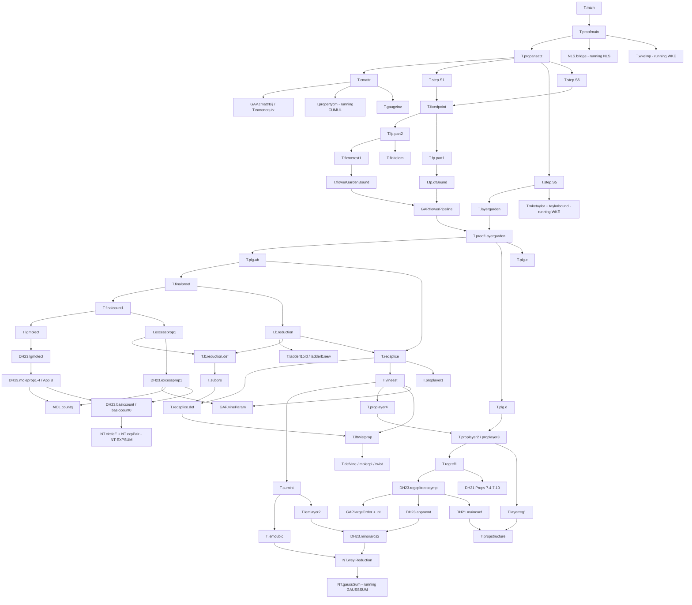

# Blueprint: node-level dependency graph for Deng–Hani, *Long time justification of wave turbulence theory*

Target: arXiv:2311.10082v2, Theorem 1.1 (`main`) for `0 < γ < 1`, square torus `𝕋_L^d = [0,L]^d`, `d ≥ 3`
(rulings D1 "everything proved in Lean", D2 "0<γ<1, square torus"; `~/WaveTurbulence-dev/docs/DECISIONS.md`).

Written 2026-11-03 (revised the same day after the refute-first topology review
`docs/campaign/orch/audits/GRAPH-topology.md`, see §G) from the maps `~/wave-turbulence/maps/{T-part1,T-part2,DH23,DH21}.md`, the TeX sources, the figures
in `~/wave-turbulence/references/src-*/`, the Wave A draft `~/WaveTurbulence-dev/scratch/Draft.lean`, the findings
ledger F1–F29 and the five running infrastructure briefs. Companion file: `WAVE-B.md` (frozen-statement proposal).

Contents
- (a) Node table (§A), conventions first.
- (b) Route decisions (§B).
- (c) Mermaid graph of the top ~40 nodes (§C).
- (d) Critical path and dependency-ready frontier (§D).
- (e) Work packets with packet-level dependencies (§E).
- (f) Totals and largest risks (§F).
- (g) Changes after the topology review of 2026-11-03 (§G).

The tables in §A are machine-checked (script in §F.4): every dependency ID exists, the graph is acyclic, and the
totals, critical path and packet dependencies in §D–§F were computed from these tables.

---------------------------------------------------------------------------------------------------------------

## A. Node table

### A.0 Conventions

- **ID prefixes.** `T.` TARGET (label or step name); `DH23.`, `DH21.`, `DH212.` (DH21-2) for results imported from
  those papers and not restated in TARGET (a TARGET restatement of a DH23 result is a single `T.` node whose source
  column also cites the DH23 item); `GIT.` GIT20; `NT.` number theory and lattice counting; `NLS.` NLS / torus /
  `a`-system theory; `PROB.` probability; `AN.` harmonic-analysis infrastructure (Fourier norms, Poisson summation,
  stationary phase, Sobolev; an extra prefix, needed because these facts are used without a citable source);
  `MOL.` molecule-level counting definitions shared by TARGET and DH23 (review I9); `GAP.` an unwritten step that
  must be supplied (each cites its FINDINGS entry, or "new").
- **Kinds.** `def` (definition, possibly frozen), `thm` (source result), `step` (substantive proof step or unlabelled
  claim), `gap` (missing argument), `infra` (imported external / standard result, now an internal node to prove).
- **Source.** `T Lxxx–Lyyy` = TARGET TeX lines; `DH23 L…`, `DH21 L…`, `DH212 L…`, `GIT20 L…` = lines of the pinned
  reference TeX; `F<n>` = `~/WaveTurbulence-dev/docs/FINDINGS.md` entry.
- **deps** = direct dependencies (IDs; `—` none). Definitions a node merely mentions through a statement it uses are
  not repeated. **consumer** = the main TARGET-side node that consumes it (one representative).
- **d** = difficulty, weight `L=1`, `M=2`, `H=4`, `VH=8`; `0` = design note (weight 0). **lines** = rough Lean size (proof + local API, not counting
  shared infrastructure listed as separate nodes). **pkt** = work packet that owns the node (§E); `R-*` = the first
  five infrastructure packets (GAUSS-HC and TORUS-FOURIER landed; CUMUL, NT-CIRCLE, WKE running); `WA` = Wave A
  definitions (frozen, D6). Status of every packet: §D, §E.
- Absolute values are written `∣x∣`, norms `∥·∥` (the ASCII bar is reserved for table syntax).
- Constants follow F5: `C_0(d,γ) → η → 𝔆 → C_1 → ν → δ (𝔇=τ*/δ ∈ ℤ) → C_2 → L`; `≲_j` = constant depending only on
  `C_j`.

### A.1 Root, induction gates and the inductive step

| ID | kind | source | statement | deps | consumer | d | lines | pkt |
|---|---|---|---|---|---|---|---|---|
| T.main | thm | T L314–L319 | Thm 1.1 (0<γ<1, square torus, d≥3): ∃θ(d,γ)>0 s.t. for Schwartz φ_in≥0, τ*<τ_max and L≥L_0: smooth NLS solution on [0,τ*T_kin] with probability ≥1−e^{−(log L)^{40d}}, and sup_{t,k}∣E(1_F∣û(t,k)∣²)−φ(t/T_kin,k)∣≤L^{−θ} (Wave A draft `main`) | T.proofmain, T.nls, T.fourier, T.data, T.wke, T.Tkin | — (root) | L | 60 | Z1 |
| T.proofmain | step | T L817–L822 (+F1, F2, F6) | proof of Thm 1.1: t=T_kin·δ·t′, p≤t′≤p+1; E(1_{F_p}∣a_k(t′)∣²)=φ(δt′,k)+O(L^{−θ_p}) from propansatz at time t′; compare F, F_p via F_𝔇 (F6) using mass conservation and Cauchy–Schwarz with E∣g∣⁴=2; P(F)≥1−e^{−N_𝔇} (F1) | T.propansatz, GAP.timeParam, NLS.bridge, NLS.akMass, PROB.cgauss, PROB.condCS, T.params, T.wkelwp, T.defC | T.main | M | 800 | Z1 |
| T.propansatz | thm | T L689–L707 | inductive ansatz at p∈[0,𝔇] (Wave B gate; time parameter): events F_p⊇F_{p+1}, gauge/translation symmetric, P(F_p)≥1−e^{−N_p}; unique a-solution on [0,p] on F_p; (ansatz1–2) two-point function φ(δp)+R_p+E_p; (ansatz3–4) cumulants of order 2R≤2R_p = Σ_{G∈𝒢_p,n(G)≤N_p}K_G+Ẽ_p; (ansatz5) order-n bound | T.ansatzBase, T.step.S1, T.cmattr, T.step.S3, T.step.S4, T.step.S5, T.step.S6, T.step.S7 | T.proofmain | M | 600 | I2 |
| T.ansatzBase | step | T L708–L709 | p=0: F_0=Ω, R_0=E_0=Ẽ_0=0; cumulants of a(0) of order ≥3 vanish; E(a_k(0)ā_ℓ(0))=1_{k=ℓ}φ_in(k) | PROB.gaussCumulant, PROB.symmetryVanish, T.defcm, T.akeqn | T.propansatz | L | 250 | I2 |
| T.step.S1 | step | T L796 (+Q16) | statement (1) at p+1: on F_{p+1} the contraction (fixedest4) gives b; a=a^tr+b solves akeqn on [p,p+1]; uniqueness in Z^Λ (Gronwall), not only in the ball; P(F_{p+1})≥1−e^{−N_p}−e^{−4N_{p+1}}≥1−e^{−N_{p+1}} | T.fixedpoint, T.defbk, NLS.akLWP | T.propansatz | M | 400 | I2 |
| T.cmattr | step | T L727–L730, L798–L801 | expansion: 𝕂_p(a^tr(t)^{ζ_1},…,a^tr(t)^{ζ_{2R}}) = Σ_{G∈𝒢^tr_{p+1}}K_G(t,k_1..k_{2R}) (couples 𝒞^tr for R=1) + terms containing E_p or Ẽ_p, t∈[p,p+1]; multilinearity, propertycm, canonical bookkeeping, time-domain factorization, ζ(G) multiplicativity | T.propertycm, T.defjt, T.defkg, T.defkg.sum, GAP.cmattrBij, T.gaugeinv, T.defgtr, GAP.timeParam | T.propansatz | H | 2500 | I1 |
| T.step.S3 | step | T L803–L804 | error E^{(1)} (terms with E_p or Ẽ_p) ≤(∏⟨k_j⟩)^{−Λ_p/4}L^{CdR_{p+1}N_{p+1}}e^{−N_p}: weighted lattice sums, transfer of decay from leaves to roots | T.cmattr, T.params, T.defkg.sum | T.propansatz | M | 600 | I1 |
| T.step.S4 | step | T L806–L807 | high orders n(G)>N^4_{p+1}: some attached G′∈𝒢_p has n(G′)≥N²_{p+1}; (ansatz5) at p with δ^{νN²}≤e^{−N²} | T.cmattr, T.params | T.propansatz | M | 400 | I1 |
| T.step.S5 | step | T L809–L810 | middle orders via layergarden (estgarden, estcouple, estcouple2) and wketaylor/taylorbound: statements (2)–(4) at p+1 up to b-terms; R_{p+1}:=Re Σ_n R_{p+1,n} (defined on ℝ^d); tail Σ_{m>N/2}𝒰_m moved into E_{p+1} | T.layergarden, T.wketaylor, T.taylorbound, T.cmattr, T.params | T.propansatz | M | 700 | I2 |
| T.step.S6 | step | T L812–L815 | b-contributions E^{(4)}: ∥b∥_Z≤e^{−10N_{p+1}} on F_{p+1}; cumulants→moments (loss (C_0R_{p+1})!), Cauchy–Schwarz, (proofmain-2) E_p∏∣a^tr_{k_j}∣²≤(C_0R)!∏⟨k_j⟩^{−3Λ_{p+1}} by re-running the expansion | T.fixedpoint, T.layergarden, T.cmattr, PROB.condCS, T.defcm | T.propansatz | M | 800 | I2 |
| T.step.S7 | step | T L815 | event change E^{(5)}: (𝕂_{p+1}−𝕂_p)(a^tr…) via moments on F_p∖F_{p+1}; P(F_p∖F_{p+1})^{1/2}≤e^{−2N_{p+1}} | T.fixedpoint, PROB.condCS, T.defcm | T.propansatz | L | 300 | I2 |
| GAP.timeParam | gap | GAP (F7, F27; T L821, L2309) | design note (weight 0; its content is counted in the time-parametrized ingredients and in the frozen statements B1.1 item 2′, B1.2): every ingredient of the step (cmattr, layergarden, wketaylor, S3–S7, fixedest1–2) holds at rescaled time t∈[p,p+1] uniformly in t (with F_{p+1}) | — | T.proofmain | 0 | 0 | D2 |
| T.layergarden | thm | T L761–L779 (proof L2229–L2256; F36: deterministic hypothesis) | Wave B gate, time t∈[p,p+1] (F27): 1≤R≤10R_{p+1}, n≤N^4_{p+1}: R≥2 (estgarden) ∣𝒦^tr_{p+1,n}(t)∣≤(∏⟨k_j⟩)^{−4Λ_{p+1}}L^{−(R−1)/4}δ^{2νn}; R=1: 𝒦^tr_{2n}=𝒰_n(t,k)+R_{2n}, 𝒦^tr_{2n+1}=R_{2n+1}, ∥R_n∥_{𝔖^{4Λ_{p+1},4Λ_{p+1}}}≤L^{−(4θ_{p+1}+θ_p)/5}δ^{2νn} | T.proofLayergarden | T.step.S5 | L | 200 | F2 |
| T.fixedpoint | thm | T L780–L794 (proof L2306–L2338) | Wave B gate: event F_{p+1}⊂F_p, symmetric, P(F_p∖F_{p+1})≤e^{−4N_{p+1}}; on F_{p+1}: (fixedest1) ∣a^tr_k(t)∣≤⟨k⟩^{−(3/2)Λ_{p+1}}e^{3N_{p+1}}, (fixedest2) ∣ℒ_0∣≤⟨k⟩^{−(3/2)Λ_{p+1}}e^{−20N_{p+1}}, (fixedest3) ∥(1−ℒ_1)^{−1}∥_{Z→Z}≤e^{3N_{p+1}}, (fixedest4) contraction on the e^{−10N_{p+1}}-ball of Z=Z^{(5/4)Λ_{p+1}}([p,p+1]) | T.fp.part1, T.fp.part2, T.fp.part3 | T.step.S1 | L | 150 | X3 |
| T.gaugeinv | step | T L567–L569, L576 | E(1_𝔉∏a_{k_j}(t_j)^{ζ_j})=0 unless Σζ_j=0 and Σζ_jk_j=0, for gauge- and translation-symmetric events 𝔉 | NLS.symmetry, PROB.symmetryVanish, NLS.akLWP | T.cmattr | M | 400 | B3 |
| T.wkelwp | thm | T L597–L603; App C L2487–L2528 | WKE: maximal Schwartz solution on [0,τ_max), uniqueness, blow-up criterion (blowuptest) for all s>d/2−1 (Wave A `wkelwp`) | T.appC.conclusion | T.main | L | 60 | R-WKE |

### A.2 Setup definitions (Wave A and Wave B)

| ID | kind | source | statement | deps | consumer | d | lines | pkt |
|---|---|---|---|---|---|---|---|---|
| T.nls | def | T L278–L285 | (NLS) (i∂_t−Δ)u+α∣u∣²u=0 on 𝕋_L^d, Δ=(2π)^{−1}Σ∂_j²; Wave A `IsSmoothNLSSolution`, `normLaplacian` | T.fourier | T.main | L | 80 | WA |
| T.fourier | def | T L286–L288 | û(t,k)=L^{−d/2}∫u e^{−2πik·x}dx, ℤ_L^d=(L^{−1}ℤ)^d; Wave A `torusFourierCoeff`, `latticePoint` | — | T.main | L | 40 | WA |
| T.data | def | T L290–L294 (+Q8a) | û_in(k)=√φ_in(k)g_k, g_k iid centered normalized circularly symmetric complex Gaussians; Wave A `stdComplexGaussian`, `initialCoeff` | — | T.main | L | 40 | WA |
| T.Tkin | def | T L296–L297 | α=L^{−γ}, T_kin=1/(2α²)=L^{2γ}/2; Wave A `kineticTime` | — | T.main | L | 10 | WA |
| T.wke | def | T L298–L311 | (WKE), (COL) through the (C.5) hyperplane parametrization; Wave A `collisionOp`, `IsWKESolution` | — | T.main | L | 60 | WA |
| T.params | def | T L605–L615, L685–L688 (F5) | parameter structure: C_0(d,γ)→η→𝔆→C_1→ν→δ (𝔇=τ*/δ∈ℤ, δ^ν≪_1 1)→C_2→L; θ_p=η^{20}(1+2^{−p}), Λ_p=(40d)^{𝔇−p+1}, R_𝔇=⌊(log L)^{40d}⌋, N_p=R_p^{40d}, R_{p−1}=N_p^{40d}, γ_0=min(γ,1−γ), γ_1=min(2γ,1,2(d−1)(1−γ)) | T.defC | T.propansatz | M | 400 | D2 |
| T.norms | def | T L579–L595 | 𝔛^{θ,Λ1,Λ2}, 𝔛^θ, 𝔖^{Λ1,Λ2}, restriction norms 𝔛(ℬ) (inf over extensions; also for lattice functions), Z^Λ(ℬ) (definitions only; API in AN.timeFourier) | — | T.propansatz | M | 500 | D2 |
| T.cutoffs | def | T L615–L623 | χ_0 (1 on ∣x∣≤1/2, 0 on ∣x∣≥1, Gevrey 2), tensor product on ℝ^d, χ_∞=1−χ_0 | AN.gevrey | T.lemlayer1 | L | 100 | N1 |
| T.akeqn | def | T L540–L566 | a-system ∂_ta_k=𝒞_+(a,ā,a)_k, a_k(0)=√φ_in(k)g_k; 𝒞_ζ with prefactor δ/(2L^{d−γ}) and phase e^{ζπiδL^{2γ}Ωt}; ε_{k1k2k3}; Ω=2⟨k1−k,k−k3⟩; 𝔊; solution class Z^Λ on [0,p] (Q16) | T.fourier, T.data, T.norms, T.defdec | T.propansatz | M | 400 | D2 |
| T.defcm | def | T L570–L577 | cumulant 𝕂 by the partition formula (eqncm) against a measure (P.restrict F) (CUMUL DRAFT `cumulant`) | — | T.propansatz | L | 60 | R-CUMUL |
| T.deftree | def | T L625–L631 (DH21 Def 2.1 L431) | ternary trees, left/mid/right children, order n, ∣ℒ∣=2n+1, signs (ζ,−ζ,ζ), ζ(𝒯)=∏(iζ_𝔫), conjugate | — | T.defgarden | L | 300 | D1 |
| T.defgarden | def | T L632–L638 (DH212 Def 4.1 L606) | gardens of signature (ζ_1..ζ_{2R}): ordered trees + sign-reversing perfect matching of all leaves; couples, proper gardens, paired trees, conjugates, irreducibility, components, multi-couples | T.deftree | T.defcanon | M | 500 | D1 |
| T.defdec | def | T L639–L648 (DH21 Def 2.4 L453) | decorations k_𝔫=k_{𝔫1}−k_{𝔫2}+k_{𝔫3}, paired leaves equal; (k_1..k_{2R})-decorations; k∈ℝ^d for couples/paired trees; ε_{k1k2k3} (defcoef0) and ε_ℐ, Ω (res) and Ω_𝔫; translation invariance | T.defgarden | T.defkg | M | 500 | D1 |
| T.deflayer | def | T L649–L656 | layerings 𝔏 (0≤𝔏_child≤𝔏_parent, paired leaves equal), pre-layerings | T.defgarden | T.defcanon | L | 120 | D1 |
| T.subobject | def | T L845–L847 | embedded sub-couples and sub-paired-trees; replace and collapse operations | T.defgarden | T.defreg | M | 600 | D1 |
| T.defcanon | def | T L657–L668 | canonical layered gardens 𝒢_p (irreducible proper) and couples 𝒞_{p+1} by the inductive construction (top trees in layer p; leaf groups B_i: pairs in layer p or gardens of 𝒢_p; irreducibility condition) | T.defgarden, T.deflayer | T.propansatz | M | 600 | D3 |
| T.canonequiv | thm | T L888–L897 (Prop 4.8; F35: (ii) for incomparable nodes) | G∈𝒢_{p+1} iff (i) all 𝔏≤p and (ii) completely paired 𝔫,𝔫′ ⇒ max(𝔏_𝔫,𝔏_𝔫′)≥min(𝔏_{𝔫^pr},𝔏_{𝔫′^pr}) (roots: p); same for 𝒞_{p+1} | T.defcanon, T.subobject | T.layerreg1 | M | 1200 | D3 |
| GAP.cmattrBij | gap | GAP (F12; T L727–L730, map Q11) | uniqueness of the construction data (top trees 𝒯_j^p, partition (B_i), attached gardens) of G∈𝒢_{p+1}, 𝒞_{p+1}, and the bijection (top trees, irreducible leaf partition, attached 𝒢_p gardens) ↔ 𝒢_{p+1} with sign and time-domain factorization | T.canonequiv, T.defcanon, T.defkg | T.cmattr | H | 2000 | D3 |
| T.defgtr | def | T L731–L732 | truncated classes 𝒢^tr_{p+1}, 𝒞^tr_{p+1} (top trees of order ≤N_{p+1}, attached gardens of order ≤N_p), well defined by GAP.cmattrBij | T.defcanon, GAP.cmattrBij, T.params | T.layergarden | L | 150 | D3 |
| T.defkg | def | T L669–L684 | K_G(t,k_1..k_{2R})=(δ/2L^{d−γ})^nζ(G)Σ_ℐε_ℐ∫_ℐ∏e^{πiζ_𝔫δL^{2γ}Ω_𝔫t_𝔫}dt_𝔫∏^{(+)}F_{𝔏_ℓ}(k_ℓ) with domain ℐ; K*_Q(t,s,k) (domain ℐ*), K*_T(t,s,k) (domain 𝒟*), k∈ℝ^d | T.defgarden, T.defdec, T.deflayer, T.akeqn, T.params | T.propansatz | M | 600 | D2 |
| T.defkg.sum | step | T L669–L684 (implicit) | absolute summability of the lattice sums in K_G, K*_Q, K*_T for inputs with 𝔖^{40d,40d} decay, measurability, sum/integral Fubini, continuity in (t,s,k) | T.defkg, T.norms | T.cmattr | M | 500 | D2 |
| T.defjt | def | T L708–L716 (+F9) | 𝒥_𝒯(t) with leaf factors a_{k_ℓ}(p)^{ζ_ℓ} (F9); 𝒥_n=Σ_{n(𝒯^+)=n}𝒥_{𝒯^+}; tree recursion 𝒥_n=Σ_{n1+n2+n3=n−1}∫_p^t𝒞_+(𝒥_{n1},𝒥̄_{n2},𝒥_{n3}) | T.defdec, T.akeqn | T.cmattr | M | 500 | D2 |
| T.defbk | def | T L717–L725 | a=a^tr+b, a^tr=Σ_{n≤N_{p+1}}𝒥_n; ℒ_0..ℒ_3 (ℝ-multilinear, conjugate in the middle slot); akeqn on [p,p+1] ⇔ b=ℒ_0+ℒ_1b+ℒ_2(b,b)+ℒ_3(b,b,b) | T.defjt, T.params | T.fixedpoint | M | 500 | D2 |

### A.3 NLS, torus Fourier analysis, the `a`-system, probability

| ID | kind | source | statement | deps | consumer | d | lines | pkt |
|---|---|---|---|---|---|---|---|---|
| NLS.torusFourier | infra | brief TORUS-FOURIER; T L286–L288 | Fourier series on 𝕋_L^d: rapid decay of coefficients of smooth periodic functions and converse, inversion, uniqueness, Parseval, derivatives, products and the cubic convolution, time differentiability | — | NLS.akReduction | H | 2500 | R-TF |
| NLS.massCons | step | T L540, L819 (implicit) | smooth NLS solutions conserve ∫∣u∣² | NLS.torusFourier, T.nls | NLS.akReduction | M | 300 | B1 |
| NLS.akReduction | step | T L540–L566 | smooth NLS solution u on [0,T] ⇒ v=e^{−2iαMt}u solves the Wick-ordered equation; a_k(t)=e^{−πiδL^{2γ}∣k∣²t}v̂(δT_kin t,k) solves akeqn; ∣a_k(t)∣=∣û(δT_kin t,k)∣ | NLS.torusFourier, NLS.massCons, T.akeqn, T.nls | NLS.bridge | M | 900 | B1 |
| NLS.akMass | step | T L819 (implicit) | Σ_k∣a_k(t)∣² is conserved for Z^Λ solutions of akeqn (Λ>d): ε symmetric and Ω odd under (k1,k2,k3,k)↦(k2,k1,k,k3) | T.akeqn | T.proofmain | M | 400 | B1 |
| NLS.akLWP | step | T L540–L566 (implicit; Q16) | a-system: local existence, uniqueness (Gronwall), continuous dependence in Z^Λ (Λ>d), blow-up alternative, persistence of higher Z^{Λ′} regularity | T.akeqn, T.norms | NLS.inverse | M | 1000 | B2 |
| PROB.smoothData | step | infra (T L314; F8) | almost surely Σ_k⟨k⟩^s√φ_in(k)∣g_k∣<∞ for every s (u_in is smooth) | PROB.cgauss, T.data | NLS.inverse | L | 200 | B2 |
| NLS.inverse | step | GAP (F8; T L818) | an a-system solution on [0,𝔇] in Z^Λ (Λ>d) with smooth data gives, by persistence of regularity and the inverse gauge (conserved mass), a C^∞ periodic NLS solution on [0,τ*T_kin] with û(t,k)=(unimodular phase)·a_k(t/(δT_kin)) | NLS.akLWP, NLS.akMass, NLS.torusFourier, PROB.smoothData | NLS.bridge | H | 1500 | B2 |
| NLS.uniqueSmooth | step | GAP (F8) | uniqueness of smooth NLS solutions on [0,T] with given data | NLS.akReduction, NLS.akLWP | NLS.bridge | M | 500 | B2 |
| NLS.measurable | step | GAP (F8; Wave A `MeasurableSet` conjunct) | measurability of the solvability event F and of ω↦1_F∣û(ω;t,k)∣² for every solution selection (via the maximal a-system existence time, lower semicontinuous by continuous dependence) | NLS.akLWP, NLS.inverse, NLS.uniqueSmooth | NLS.bridge | H | 1500 | B3 |
| NLS.symmetry | step | T L567–L569 (implicit) | gauge u↦e^{iθ}u and translation u↦u(·−x_0) act on data by g_k↦e^{iθ}g_k, g_k↦e^{−2πik·x_0}g_k, preserve the iid circular law and commute with the solution map | NLS.akLWP, PROB.cgauss, T.akeqn | T.gaugeinv | M | 500 | B3 |
| NLS.bridge | step | T L817–L819 (F6, F8) | F_𝔇∩{u_in smooth}⊂F; on F, ∣û(t,k)∣=∣a_k(t/(δT_kin))∣ for the unique solution; comparison of E(1_F∣û∣²) with E(1_{F_p}∣a_k∣²) | NLS.inverse, NLS.uniqueSmooth, NLS.measurable, NLS.akReduction | T.proofmain | M | 600 | B3 |
| PROB.cgauss | infra | brief CUMUL; T L290–L294; DH21 L297 | `stdComplexGaussian`: probability measure, E g^aḡ^b=a!δ_{ab} (E∣g∣⁴=2), rotation invariance, iid families on ℤ^d via `Measure.infinitePi` | — | PROB.isserlis | M | 800 | R-CUMUL |
| PROB.isserlis | infra | DH21 L2797–L2807 (Lemma A.2) | complex Isserlis: E∏η_{k_j}^{ζ_j}=Σ over sign-opposite pairings of ∏1_{k_j=k_j′} | PROB.cgauss | PROB.gaussCumulant | M | 600 | R-CUMUL |
| PROB.cumulInv | infra | T L573 (eqncm2) | moment = Σ_{partitions}∏ cumulants (Möbius inversion), any finite measure | T.defcm | T.propertycm | M | 600 | R-CUMUL |
| T.propertycm | thm | T L2343–L2351 (Lemma A.1; F30 wording: nonempty A, nonempty S_i) | Leonov–Shiryaev: 𝕂(Y_1..Y_r)=Σ over partitions of ∪S_i irreducible w.r.t. (S_i) of ∏𝕂((X_j)_{j∈B}) | PROB.cumulInv | T.cmattr | M | 800 | R-CUMUL |
| PROB.gaussCumulant | infra | T L708 | Gaussian cumulants of order ≥3 vanish; pair cumulants 1_{k=k′} (opposite signs) | PROB.isserlis, PROB.cumulInv | T.ansatzBase | M | 400 | R-CUMUL |
| PROB.symmetryVanish | infra | T L567–L570 | invariance of the joint law under X_j↦e^{iζ_jθ}X_j (resp. translation phases) ⇒ moments and cumulants vanish unless Σζ_j=0 (resp. Σζ_jk_j=0) | T.defcm | T.gaugeinv | M | 300 | R-CUMUL |
| PROB.condCS | step | T L813–L815, L819 | inequalities for E_p=E(1_{F_p}·): Cauchy–Schwarz, cumulant↔moment conversion with (C_0R)! losses, E(1_A∣g∣²)≤√2·P(A)^{1/2} | T.defcm, PROB.cgauss | T.step.S6 | M | 500 | I1 |
| PROB.chebyshev | infra | Mathlib | Markov/Chebyshev for 2P-th moments; union bounds over countable dyadic families | — | T.fp.part1 | L | 50 | X3 |
| DH21.largedev | infra | DH21 L2808–L2813 (Lemma A.3; Oh–Thomann Lemma 2.6); F34 | Gaussian hypercontractivity E∣X∣^q≤(q−1)^{nq/2}(E∣X∣²)^{q/2}; NOT on the TARGET route (TARGET's large deviations use 2P-th moments from the cumulant ansatz, L2314–L2334) | PROB.cgauss | — (off-route) | H | 2500 | R-GAUSS |

### A.4 Wave kinetic equation (Appendix C, Taylor expansion)

| ID | kind | source | statement | deps | consumer | d | lines | pkt |
|---|---|---|---|---|---|---|---|---|
| T.appC.decomp | step | T L2487–L2511 | 𝒦=Σ_j(−1)^j𝒦_j; translation form (schappend5), Leibniz rule (schappend6), moment identity (schappend7) and multi-index iterates; integrability of all integrands | T.wke | T.appC.lwp | M | 900 | R-WKE |
| WKE.deltaChar | step | brief WKE goal 1; T L306–L310; GIT20 L981 | characterization of `collisionOp` as the ε→0 limit of ε^{−1}ψ(Ω/ε)-mollified integrals (confirms the Wave A delta reading) | T.wke | T.wkelwp | M | 600 | R-WKE |
| GIT.trilinear | infra | GIT20 Lemmas 4.1–4.3, Rem 2.6 (Kin8.tex L885–L1100, proved for d=3 only; Rem 2.6 L592–L594 asserts general d); T L2513–L2516 (F18, F32: d≥4 is new work) | ∥𝒦_j(φ_1,φ_2,φ_3)∥_{Z_s}≤C(s)∏∥φ_i∥_{Z_s}, Z_s=⟨k⟩^{−s}L², s>d/2−1, every d≥3 | T.appC.decomp | T.appC.lwp | H | 3000 | R-WKE |
| T.appC.lwp | step | T L2513–L2516 | local well-posedness in Z_s and Z_{s,m} by Picard iteration; lifespan ≳(C(s)∥φ_in∥²_{Z_s})^{−1} | GIT.trilinear, T.appC.decomp | T.appC.conclusion | M | 600 | R-WKE |
| T.appC.apriori | step | T L2518–L2524 | persistence of moments and derivatives (schappend9–11; multinomial coefficients, Q13b), Gronwall | T.appC.lwp | T.appC.conclusion | M | 700 | R-WKE |
| T.appC.conclusion | step | T L2526–L2528 | all lifespans τ^{(s,m)}_max coincide; φ(τ)∈𝒮; blow-up criterion with lim; uniqueness in C([0,τ),Z_s); relation to `IsWKESolution` | T.appC.apriori | T.wkelwp | M | 900 | R-WKE |
| T.defC | step | T L607 | 𝔆=sup_{[0,τ*]}∥φ(τ)∥_{𝔖^{40d,40d}}<∞, and sup_{[0,τ*]}∥φ(τ)∥_{𝔖^{Λ,Λ}}<∞ for every Λ (these are C_2-constants) | T.wkelwp | T.params | L | 150 | R-WKE |
| GAP.wkeTame | gap | GAP (F10; T L752–L758) | tame estimate for 𝒦 in the sup-based norms 𝔖^{Λ,Λ}: high norm on one factor, 𝔖^{40d,40d} on the others, constant independent of Λ in the linear part; convergence radius depending only on 𝔆 | T.appC.decomp | T.taylorbound | H | 1500 | R-WKE |
| T.wketaylor | step | T L752–L755 | φ(τ)=Σ_n𝒰_n(t) for τ=δt, t∈[p,p+1] (wketaylor2 Picard–Taylor terms), δ small w.r.t. 𝔆; identification with the Schwartz solution by uniqueness | GAP.wkeTame, T.wkelwp, T.defC | T.step.S5 | M | 800 | R-WKE |
| T.taylorbound | step | T L756–L758 | sup_{t∈[p,p+1]}∥𝒰_n(t)∥_{𝔖^{4Λ_{p+1},4Λ_{p+1}}}≤C_2(C_1δ)^n | GAP.wkeTame, T.wketaylor | T.step.S5 | M | 600 | R-WKE |

### A.5 Harmonic-analysis infrastructure

| ID | kind | source | statement | deps | consumer | d | lines | pkt |
|---|---|---|---|---|---|---|---|---|
| AN.gevrey | infra | T L615–L623; DH21 L982 (Rodino) | Gevrey-2 cutoffs with m-th derivatives ≤(2m)!, Fourier decay e^{−c∣ξ∣^{1/2}}, closure under products | — | T.cutoffs | M | 800 | N1 |
| AN.timeFourier | infra | T L579–L595 | time Fourier transform on ℝ^r; weighted-L¹ Fourier norms 𝔛^θ (with L^∞_k inside); restriction norms (inf over extensions); products, translations, modulations, cutoffs, Hölder interpolation in θ | — | T.norms | H | 2000 | N1 |
| AN.fourierL1Product | infra | T L1007–L1012 | Fourier-L¹ norms of products of localized smooth factors under unimodular integer changes of variables (≤C^n∏ of W^{d+1,1}-type norms) | AN.timeFourier, AN.gevrey | T.pl1.S2 | M | 600 | N1 |
| AN.poisson | infra | T L1035, L1541, L1575 | Poisson summation on ℤ_L^d=L^{−1}ℤ^d and on products, for Schwartz / compactly supported smooth functions | — | T.lemlayer1 | M | 600 | N2 |
| AN.nonStat | infra | T L966, L1550 | non-stationary phase: repeated integration by parts, ∣∫χ(x−a)e(⟨w,x⟩)dx∣≲_N⟨w⟩^{−N} uniformly in a | AN.gevrey | T.lemlayer1 | L | 300 | N2 |
| AN.statPhase | infra | T L968; DH23 L1013ff | ∣∫χ_0(x−a)χ_0(y−b)e(⟨ξ,x⟩+⟨ξ′,y⟩+s⟨x,y⟩)dxdy∣≲⟨s⟩^{−d} uniformly (bilinear phase; exact Fourier computation, no general stationary phase) | AN.nonStat | T.lemlayer1 | M | 800 | N2 |
| AN.hausdorffYoung | infra | T L2370 | Hausdorff–Young ∥F̂∥_{L^{p′}(ℝ²)}≤∥F∥_{L^p(ℝ²)}, 1≤p≤2 (or Riesz–Thorin) | — | T.timeintlem | H | 2000 | N3 |
| AN.dny21 | infra | DNY21 Lemma 3.1 (not pinned, F29); T L2365 | kernel of the truncated Duhamel operator ℐ_χ: ∣K(ξ,σ,ξ′,σ′)∣≲⟨ξ⟩^{−1}⟨ξ−ξ′⟩^{−1}⟨σ⟩^{−1}⟨σ−σ′⟩^{−1} | AN.timeFourier | T.timeintlem | M | 700 | N3 |
| AN.sobolev | infra | T L998, L2314, L2330 | weighted W^{d,1}(ℝ^d)⊂L^∞ (incohproof4); H¹([p,p+1])⊂L^∞ (sobolev); Morrey/Gagliardo–Nirenberg on squares (sobolev2) | — | T.pl1.S2 | M | 1000 | N4 |
| AN.simplexVol | infra | T L2029–L2036 | volumes of heap-ordered simplices and of two interleaved monotone sequences in [0,𝔇]^z; x^z/(z−d)!≤x^de^x | — | T.ladderl1old | M | 500 | N4 |
| DH21.elemineq | infra | DH21 L2428 ((10.5)); T L2004 | sup_{[0,1]^n}∣F∣≤Σ_{A}∫_{[0,1]^n}∣∏_{v∈A}(∂_{α_v}−πi𝔏_v)F∣ | — | T.ladderl1old | L | 300 | N4 |
| DH21.timeintlemma | infra | DH21 L2432–L2451 (Lemma 10.2; DH19 Prop 2.3, DH19 L347–L407 region, label to pin) | ∣U_T(t,σ,α[𝒩])∣≤C^nΣ_{d∈{0,1}^𝒩}∏_𝔫⟨q_𝔫⟩^{−1} for iterated oscillatory time integrals over heap-ordered domains | AN.simplexVol | T.ladderl1old | M | 900 | N4 |
| AN.resonantMeasure | infra | T L2502–L2505; DH21 L1814–L1837 | the resonant measure δ(k_1−k_2+k_3−k)δ(Ω)dk via the ℓ_1-hyperplane parametrization shared with `collisionOp`; principal value p.v.1/Ω in the same parametrization; bounds and smooth dependence on k | T.wke | DH21.multiexp | H | 1800 | N5 |
| DH21.NTOmegainv | infra | DH21 L1305–L1367 (Lemma 6.3) | principal-value limits lim_{μ→∞}∫Ω^{−1}χ_∞(μΩ)χ_0χ_0Θe(·) exist, with uniform bounds | AN.resonantMeasure | DH23.approxnt | M | 1000 | N5 |

### A.6 Number theory and lattice counting

| ID | kind | source | statement | deps | consumer | d | lines | pkt |
|---|---|---|---|---|---|---|---|---|
| NT.circle23 | infra | brief NT-CIRCLE (F3) | stepping stone (off-route since F3 revised): ∣#{n∈ℤ²:∣n−c∣≤Q}−πQ²∣≤CQ^{2/3} uniformly in c; suffices for basiccount0 (1), (3) and basiccount (5) but not for basiccount0 (2) | — | — (off-route) | H | 2500 | R-NTC |
| NT.expPair | infra | F3 (revised); brief NT-CIRCLE-v2 goals 1, 4; packet NT-EXPSUM (review I12, P7) | 1-D van der Corput toolkit: ψ(x)=x−⌊x⌋−1/2 with truncated Fourier expansion, Kusmin–Landau, second-derivative test, A-process (Weyl differencing), B-process (1-D Poisson summation + stationary phase with explicit errors); an exponent pair with (κ+λ)/(1+κ)<2/3, e.g. (11/30,16/30) | — | NT.circleE | VH | 3000 | NT-EXPSUM |
| NT.circleE | infra | F3 (revised); review I12, P8 | ∣#{n∈ℤ²:∣n−c∣≤Q}−πQ²∣≤CQ^e uniformly in c∈ℝ², Q≥1, for a fixed e<2/3 (e=27/41 from (11/30,16/30)); any fixed e<2/3 suffices once η is small | NT.expPair | NT.annulus | H | 1500 | NT-EXPSUM |
| NT.annulus | infra | DH23 L2028–L2031 (Lemma A.1(1); exponent e<2/3 instead of 7/11, F3 revised; typo F31) | lattice points in annulus(Q,ρ) ∩ disc(L): ≲min(Qρ+Q^e, (Qρ)^{1/2}+L(Qρ)^{3/2}Q^{−1}+L(Qρ)^{1/2}Q^{−1/3}) with the exponent e<2/3 of NT.circleE | NT.circleE | DH23.basiccount0 | M | 800 | NT-EXPSUM |
| DH23.estcross | infra | DH23 L2032–L2047 (Lemma A.1(2)) | #{x∈A∩ℤ^d: sup_{B,α}#{y∈B∩ℤ^d:∣x·y−α∣≲ρ}≳L^{d−1}θ^{−1}}≲ρ^d+L^{d−2}(log L)^Cρ²θ² | — | DH23.basiccount0 | M | 800 | R-NTC |
| NT.dirichlet | infra | Mathlib (`Real.exists_rat_abs_sub_le_and_den_le`) | Dirichlet approximation: ∣t−a/q∣≤1/(qK), 1≤q≤K, gcd(a,q)=1 | — | NT.gaussSum | L | 100 | NT1 |
| NT.gaussSum | infra | DH23 L1100–L1136 ('Gauss lemma'); DH21 L1445 (GaussLem); T L1564 ('wyel') | quadratic Weyl sums: ∣Σ_{p=h}^{h+K}e(sp²+rp)∣≲K log K/(√q(1+K∣s−a/q∣^{1/2})) for ∣s−a/q∣≤1/(qK), (a,q)=1, q≤K; smooth-cutoff variant sup_{h,ρ}∣Σ_xχ_0((x−h)/L)e(t′x²+ρx)∣ | NT.dirichlet | DH23.minorarcs2 | H | 2000 | NT1 |
| DH21.hua | infra | DH21 L2823–L2833 (Lemma A.5) | ∥G_h(·,r,n)∥⁴_{L⁴[0,1]}≲n²log(2+n), ∥G_h∥⁶_{L⁶}≲n⁴ uniformly in (r,h) (counting a²−b²+c²−d²=0, gcd sums) | — | DH23.minorarcs1 | M | 1200 | NT2 |
| NT.weylReduction | infra | DH23 L1076–L1136; T L1560 (review I17, P9) | the shared "standard reductions" of DH23 Lemma 6.6: Σ_{x,y(,z)∈ℤ_L^d}∏χ_0(·−a)·e(quadratic phase) reduced to products of 1-D Weyl sums, with compactly supported replacements of χ̂_0 and shifts of the linear frequencies | NT.gaussSum, AN.poisson, AN.gevrey | DH23.minorarcs2 | M | 800 | NT2 |
| NT.weylMoment | infra | T L1567–L1590 | ∫_0^1∣G(t′)∣^{3d/2}dt′≲L^{3d/2−2} (3d/2>4) and the localized major-arc variant ≲_2L^{3d/2−2+(2γ−2)} | NT.gaussSum, DH21.hua, NT.dirichlet | T.lemcubic | H | 1500 | NT2 |
| DH23.minorarcs1 | infra | DH23 L1076–L1090 (Lemma 6.6(1)); DH21 L1368 (Lemma 6.4(1)) | supp Φ⊂{∣s∣<L^{2γ}}: ∫∣Σ_{(x,y)∈ℤ_L^{2d}}Φχ_0χ_0e(x·ξ+y·ζ+s⟨x,y⟩)∣ds≲Dλ^{4d}L^{2d} | DH21.hua, AN.poisson, NT.weylReduction | NT.threeVec | H | 1500 | NT3 |
| NT.threeVec | infra | DH23 L2110 (basiccount(2) via DH21 Prop 6.1, A.9(2)); T L2472 (𝔈_3) | #{(x,y) in unit balls: ∣⟨x,y⟩−β∣≤δ^{−1}L^{−2γ}}≲δ^{−1}L^{2(d−γ)} on the square torus (smooth majorant + minorarcs1) | DH23.minorarcs1, AN.gevrey | DH23.basiccount | M | 500 | NT3 |
| DH23.minorarcs2 | infra | DH23 L1090–L1136 (Lemma 6.6(2)) | supp Φ⊂{∣s∣≳L}, P>η^{−2}: ∫⟨s/(δL^{2γ})⟩^{−P}∣Σ_{(x,y)}…∣ds≲Dλ^{4d}L^{2d−2(d−1)(1−γ)+η} (trivial for γ<1/2; Gauss sums, refined Hua, Dirichlet) | NT.gaussSum, NT.dirichlet, AN.poisson, NT.weylReduction | T.lemlayer2 | H | 3000 | NT4 |
| T.lemlayer2 | thm | T L970–L977 (Lemma 5.3) | ∫_{L≤∣s∣≤𝔇δL^{2γ}}∣Σ_{(x,y)∈ℤ_L^{2d}}χ_0χ_0e(⟨x,ξ⟩+⟨y,ξ′⟩+s⟨x,y⟩)∣ds≲_2L^{2d−2(d−1)(1−γ)+η} | DH23.minorarcs2 | T.pl1.S3 | L | 200 | NT4 |
| DH23.NTSP | infra | DH23 L1013–L1074 (Lemma 6.5) | (1) ∫_ℝ∣∫χχΦe(ξ·x+ζ·y+s⟨x,y⟩)∣ds≲Dλ^{2d}; (2) nonzero Poisson modes ≲Dλ^{2d}L^{−1+2η}(1+∣ξ∣+∣ζ∣) for supp Φ⊂{∣s∣≲L} | AN.statPhase, AN.nonStat, AN.poisson | DH23.approxnt | H | 2500 | NT5 |
| T.lemlayer1 | thm | T L958–L969 (Lemma 5.2) | ∣s∣≤L: Σ_{(g,h)∈ℤ^{2d}}∣∫χ_0(x−a)χ_0(y−b)e[⟨Lg+ξ,x⟩+⟨Lh+ξ′,y⟩+s⟨x,y⟩]dxdy∣≲_0⟨s⟩^{−d} | AN.statPhase, AN.nonStat, T.cutoffs | T.pl1.S3 | M | 800 | NT5 |
| DH23.NTintlem | infra | DH23 L1143–L1156 (Lemma 6.7) | μ^{−1}∫ψ(μΩ)χ_0χ_0Φe(·) bounded, and → (∫ψ)∫δ(Ω)χ_0χ_0Φe(·) with error Dλ^{2d}μ^{−(1−2η)}(1+∣ξ∣+∣ζ∣) | AN.resonantMeasure, AN.statPhase | DH23.approxnt | M | 1000 | NT5 |
| DH23.approxnt | infra | DH23 L984–L1010 (Prop 6.4; proof = DH21 Prop 6.1, DH21 L1504–L1657) | I=Σ_{x,y}WΨ(δL^{2γ}⟨x_j,y_j⟩)=L^{2dn}∫WΨ+O((λ)^C(C^+L^{2d−2γ}δ^{−1})^nL^{−γ_1+η}); I_app with p.v.1/⟨x,y⟩ and δ(⟨x,y⟩) factors; triangular support structure | DH23.NTSP, DH23.minorarcs1, DH23.minorarcs2, DH23.NTintlem, DH21.NTOmegainv, AN.poisson, AN.gevrey | DH23.regcpltreeasymp | VH | 5000 | NT6 |
| GAP.largeOrder.nt | gap | GAP (F33; DH23 L984–L1010 with λ_j≤(log L)^4, n≤N³; review I13) | DH23 Prop 6.4 (approxnt) for n≤N^4_{p+1}=(log L)^{C(𝔇)} variables and box sizes λ_j with ∏λ_j≤C^n: the major/minor-arc error (λ)^C(C^+L^{2d−2γ}δ^{−1})^nL^{−γ_1+η} uniform in that range (union bounds over n coordinates cost n^{O(1)}≤L^{η}) | DH23.approxnt | GAP.largeOrder | H | 1200 | NT6 |
| GAP.circle23 | gap | GAP (F3 revised, F31; DH23 L2076–L2117) | redo DH23 basiccount0 (1)–(3) and basiccount (5) with the exponent e<2/3 of NT.circleE (F3 revised: 2/3 suffices for (1), (3), (5); (2), γ>4/5−10η, needs e<2/3 strictly) and the two-branch reading of (disclattice) (F31); check every min(·,·) against the required power of L | NT.annulus | DH23.basiccount0 | M | 400 | NT7 |
| DH23.basiccount0 | infra | DH23 L2048–L2096 (Lemma A.2) | 𝒞_1=#{(x,y):∣x·y−α∣,∣r·ξ−β∣≤δ^{−1}L^{−2γ}}≲δ^{−1}L^{2(d−γ)}𝔛^{−1}; refined bound for γ>4/5 (needs e<2/3); 𝒞_2≲δ^{−2}L^{3(d−γ)−γ_0} (route F3 revised) | NT.annulus, DH23.estcross, NT.threeVec, GAP.circle23 | T.countlem | H | 2500 | NT7 |
| T.countlem | thm | T L2459–L2466 (Lemma A.8) | (basiccount01)≲_1δ^{−1}L^{2(d−γ)}𝔛^{−1}, (basiccount02)≲_1δ^{−2}L^{3(d−γ)−γ_0} | DH23.basiccount0 | T.excessprop1 | L | 150 | NT7 |
| NT.twoVec | infra | DH23 L2102 (basiccount(1)); DH21 L2881 (Lemma A.9(1)) | 2-vector counts {k_1±k_2=k, ∣∣k_1∣²±∣k_2∣²−β∣≤δ^{−1}L^{−2γ}}: ≲δ^{−1}L^{d−γ−γ_0} (equal signs); ≲L^{d−1}+δ^{−1}min(R^{−1}L^{d−2γ},L^d) (opposite signs, ∣k_1−k_2∣∼R) | NT.annulus | DH23.basiccount | M | 600 | NT8 |
| DH23.basiccount | infra | DH23 L2097–L2114 (Lemma A.3) | atom-system counts (1)–(5) for systems of ≤4 vectors (2-, 3-, 4-vector and the (5) bound δ^{−3}L^{3(d−γ)−1.01γ_0}) | NT.twoVec, NT.threeVec, DH23.basiccount0, NT.annulus | T.atomcountlem | H | 3000 | NT8 |
| T.atomcountlem | thm | T L2467–L2478 (Lemma A.9; Q8b; F36: atomcountbd3 unused) | 𝔈_2≲_1δ^{−1}min(L^d,L^{d+1−2γ}); 𝔈_2≲_1δ^{−1}L^{d−γ−η} if ∣k_1−k_2∣≥L^{−γ+η}; 𝔈_3≲_1δ^{−1}L^{2(d−γ)}; 𝔈_4≲_1δ^{−1}L^{2(d−γ)}𝔛^{−1} | DH23.basiccount | T.excessprop1 | L | 200 | NT8 |
| T.finitelem | thm | T L2435–L2445 (Lemma A.6) | M≥L: each k∈ℤ_L^d has a system (q≤d, v_j, y) of height ≤M^{C_0} representing ⟨k,z⟩ for ∣z∣≤M, ∣⟨k,z⟩∣≤M; a set 𝔑𝔢𝔭 of ≤M^{C_0} representatives | — | T.fp.part2 | M | 1000 | NT9 |
| T.lincomblem | thm | T L2449–L2457 (Lemma A.7) | q≤d vectors of a finite S⊂ℝ^d span S with coefficients ≤2^{d−1} (max-volume selection) | — | T.ladderl1old | M | 400 | NT9 |
| T.lemlin | thm | T L1536–L1543 | L^{−1}≤∣r∣≤L^{−γ+η}: ∫_{[τ,τ+δL^{2γ}]}∣Σ_xχ_0(x−a)e(s⟨r,x⟩+⟨ξ,x⟩)∣ds≲_0min(δL^{d+2γ},L^d∣r∣^{−1}) | AN.poisson, T.cutoffs | T.sumint.S2 | M | 500 | NT10 |
| T.lemcubic0 | thm | T L1544–L1553 | ∣s∣,∣t∣≤L, Λ∈{⟨x,z⟩,⟨z,x+y−z⟩}: Σ_{(g,h,q)∈ℤ^{3d}}∣∫χχχe[…]e(t⟨x,y⟩+sΛ)∣≲_0(1+∣s∣+∣t∣)^{−d} | AN.statPhase, AN.nonStat | T.sumint.S2 | M | 1000 | NT10 |
| GAP.lemcubicRed | gap | GAP (map T-part2 Q8; T L1560–L1590) | the lemcubic-specific part of the reduction: diagonalization (u,v,w)=(x+y,x−y,x+y−2z) for Λ=⟨z,x+y−z⟩ and the level-set argument for Λ=⟨x,z⟩, on top of NT.weylReduction | NT.gaussSum, AN.poisson, NT.weylReduction | T.lemcubic | M | 500 | NT11 |
| T.lemcubic | thm | T L1554–L1593 | ∫_{L≤max(∣t∣,∣s∣)≤𝔇δL^{2γ}}∣Σ_{x,y,z∈ℤ_L^d}χχχe(t⟨x,y⟩+sΛ+⟨ξ,x⟩+⟨ξ′,y⟩+⟨ξ″,z⟩)∣dtds≲_2L^{3d+γ−2γ_0}log L | NT.weylMoment, NT.gaussSum, NT.dirichlet, GAP.lemcubicRed, AN.poisson, NT.weylReduction | T.sumint.S2 | H | 2500 | NT11 |

### A.7 Regular couples, skeletons, links, layered regular objects (combinatorics; DH21 §4, DH21-2 §4, TARGET §4)

| ID | kind | source | statement | deps | consumer | d | lines | pkt |
|---|---|---|---|---|---|---|---|---|
| T.defreg | def | T L825–L844 (DH21 Defs 4.1–4.2 L697–L728; Figs MiniCpl.png, MiniTree.png, OperAB.png) | (1,1)-mini-couples (codes 00, 01), mini trees (codes 10,11,20,21,30,31), operations A and B, regular couples (generated from the trivial couple by A, B), regular trees — textual definitions in WAVE-B §3.2 | T.subobject | T.propstructure | M | 700 | D4 |
| T.defregchain | def | T L848–L850 (DH21 Defs 4.4, 4.6 L739–L751) | legal (non-crossing) pair partitions of {1..2m}; regular chains; dominant chains | T.defreg | T.propstructure | M | 400 | D4 |
| DH21.legalpair | thm | DH21 L741–L749 (Prop 4.5) | legal partitions ⇔ iterated insertion of adjacent pairs ⇔ concatenation/enclosure | T.defregchain | DH21.prop34 | M | 400 | D4 |
| DH21.prop34 | thm | DH21 L752–L761 (Prop 4.7) | regular chains ↔ (legal partition, mini-tree code per pair); dominant iff the partition is dominant; order even | DH21.legalpair, T.defreg | DH21.structure1 | M | 900 | D4 |
| DH21.structure1 | thm | DH21 L762–L790 (Prop 4.8) | every nontrivial regular couple is a (1,1)-mini-couple or a regular double chain with leaf pairs replaced by regular couples | DH21.prop34, T.defreg | T.propstructure | H | 1500 | C1 |
| DH21.structure15 | thm | DH21 L791–L796 (Prop 4.10) | type 1/2 well defined (property L); type-2 representation unique when the lone-pair couple is trivial or of type 1 | DH21.structure1 | GAP.structUniq | M | 800 | C1 |
| GAP.structUniq | gap | GAP (F12; T L851–L869; map T-part1 Q9) | uniqueness of all structure data (Q_j; chains 𝒳^ε; Q_{j,ε,ι}; Q_lp of type 1 or trivial) and of the red/green/blue assignment in Prop propstructure | DH21.structure15 | T.propstructure | M | 800 | C1 |
| DH21.countcouple1 | thm | DH21 L776–L790 (Cor 4.9; DH21 map E7) | #regular couples (and regular trees) of order 2m ≤C_0^m | DH21.structure1, DH21.prop34 | T.propstructure | M | 600 | C1 |
| T.propstructure | thm | T L851–L869 (Prop 4.4) | structure theorem: type 1 (Q_1,Q_2,Q_3) / type 2 (𝒳^±, Q_{j,ε,ι}, Q_lp), unique; regular-tree analogue (𝒳_0, Q_{j,0,ι}); dominant couples/trees; counting ≤C_0^m — Wave B interface | DH21.structure1, DH21.structure15, GAP.structUniq, DH21.countcouple1, T.defregchain | T.layerreg1 | L | 300 | C1 |
| DH21.branchpair | thm | DH21 L729–L737 (Prop 4.3) | regular couples: unique pairing of branching nodes with ζ_{𝔫′}Ω_{𝔫′}=−ζ_𝔫Ω_𝔫 for every decoration | T.defreg, T.defdec | T.deflink | M | 800 | C2 |
| DH21.defchoice | def | DH21 L798–L812 (Def 4.11); T L874–L882 (review I10) | the choice set 𝒩^ch: one node from each linked pair (+ root for type 1, n_a with a<b for chains), fixed through the structure theorem | DH21.branchpair, T.propstructure | DH21.Bcstruct | L | 300 | C2 |
| GAP.linkXY | gap | GAP (F16; DH21 Fig BranPair.png) | for linked (𝔫,𝔫′): {x_{𝔫′},y_{𝔫′}}={±x_𝔫,±y_𝔫}, (x,y)=(k_{𝔫1}−k_𝔫,k_𝔫−k_{𝔫3}) (checked on the two mini pieces, then by induction) | DH21.branchpair, T.propstructure | T.deflink | M | 500 | C2 |
| T.deflink | thm | T L874–L882 (Prop 4.6) | links defined through the structure theorem coincide with the DH21 pairing; choice set 𝒩^ch; ζΩ antisymmetry, (x,y) relation, ε_𝔫=ε_{𝔫′} | DH21.branchpair, GAP.linkXY, T.propstructure, DH21.defchoice | T.pl1.S1 | L | 300 | C2 |
| T.defcoh | def | T L885–L887 (Def 4.7) | coherent layered regular couples/trees; incoherency index g | T.deflink, T.deflayer | T.layerreg1 | L | 100 | C2 |
| DH21.auxlem | thm | DH21 L1659–L1664 (Lemma 6.6) | ∏_{𝔫∈𝒩}μ°_𝔫≤3^n/(2n+1) (second-largest child leaf counts) | T.deftree | T.treelemma | L | 250 | C2 |
| DH23.explem | thm | DH23 L2116–L2127 (Lemma A.4) | decorations with leaves in unit balls split into ≤C^n sub-collections on which every k_𝔫 lies in a fixed unit ball (and the r·k_𝔫 variant) | DH21.auxlem, T.defdec | T.treelemma | M | 500 | C2 |
| T.treelemma | thm | T L2422–L2430 (Lemma A.4) | node ordering with short leaf-sum differences (∏Λ_j≤C_0^m); localization into ≤C_0^m sub-collections | DH21.auxlem, DH23.explem | T.pl1.S2 | L | 250 | C2 |
| DH21.reduceprocess | thm | DH21 L814–L823 (Def 4.12, Prop 4.13) | unique prime skeleton Q_sk via confluent collapse of embedded mini-couples and mini trees (diamond lemma) | T.defreg, T.subobject | DH21.structure2 | H | 1500 | C3 |
| GAP.skeletonUniq | gap | GAP (F12; DH21 map E4; DH21 L833, DH212 L641) | the 'case-by-case argument': the intermediate couple Q_int has no nontrivial regular sub-couple (uniqueness of the skeleton decomposition) | DH21.reduceprocess, DH21.structure1 | DH21.structure2 | M | 800 | C3 |
| DH21.structure2 | thm | DH21 L824–L837 (Prop 4.14, Rem 4.15) | Q is obtained uniquely from Q_sk by replacing branching nodes by regular chains and then leaf pairs by regular couples; regular trees = regular chains with regular couples | DH21.reduceprocess, GAP.skeletonUniq, DH21.structure1 | DH212.skeleton | H | 1500 | C3 |
| DH21.corcpl | thm | DH21 L848–L852 (Cor 4.16) | given Q_sk, #couples of order ≤n with skeleton Q_sk ≤C^n | DH21.structure2, DH21.countcouple1 | DH212.skeleton | M | 400 | C3 |
| DH212.skeleton | thm | DH212 L619–L649 (Props 4.4–4.6) | gardens: unique prime skeleton, unique reconstruction by regular couples/trees, ≤C^{m+R} gardens per skeleton | DH21.structure2, DH21.corcpl, T.defgarden | T.propstructure2 | M | 800 | C3 |
| T.propstructure2 | thm | T L870–L873 (Prop 4.5) | prime skeleton 𝒢_sk of any garden; unique replacement data; ≤C_0^{m+R} gardens per skeleton | DH212.skeleton | T.regred | L | 200 | C3 |
| T.layerreg1 | thm | T L898–L931 (Prop 4.9) | coherent layered regular couple/tree embedded in a canonical garden: layer structure (type 1: single layer q′; type 2/tree: monotone chain layers between q′ and q); interchangeability preserving canonicity | T.propstructure, T.deflink, T.defcoh, T.canonequiv | T.proplayer2 | H | 2500 | C4 |
| T.layerreg2 | thm | T L932–L948 (Prop 4.10; Q10) | #layerings of a regular couple/tree of order 2m with incoherency g in canonical gardens, (q,q′) fixed: ≤C_2^gC_0^{m+∣q−q′∣} (for a fixed couple; structure count separate) | T.layerreg1, T.propstructure, T.canonequiv | T.plg.c | H | 1500 | C4 |
| DH21.defstd | def | DH21 L854–L860 (Def 4.17) | dominant couples (inductive; dominant chains, dominant sub-couples) | T.propstructure | T.defencpl | L | 150 | C5 |
| DH21.equivcpl | def | DH21 L862–L911 (Def 4.18, §4.4.3) | special subsets Z⊂𝒩^ch; enhanced dominant couples; equivalence ~ via multisets of tuples (𝙸,𝚌,𝒳_1,𝒳_2) and the class of Q_lp | DH21.defstd, T.deflink | T.defencpl | M | 900 | C5 |
| T.defencpl | def | T L1126–L1137 (Def 6.4) | enhanced dominant couples with all nodes in one layer; equivalence (unionch, unionz) | DH21.equivcpl, T.deflayer | T.regref1 | M | 500 | C5 |
| T.defentree | def | T L1138–L1144 (Def 6.5) | enhanced dominant trees; equivalence | T.defencpl | T.regref1 | M | 400 | C5 |
| DH21.encoded | thm | DH21 L874–L895 (Defs 4.19–4.22, Props 4.20, 4.23) | encoded trees (codes 0–3) and chains; the map from dominant couples to encoded trees is onto and respects ~ | DH21.equivcpl | DH21.wkeTaylorId | M | 1200 | C5 |

### A.8 Regular-couple asymptotics (DH21 §5, §7, γ-free; DH23 §6)

| ID | kind | source | statement | deps | consumer | d | lines | pkt |
|---|---|---|---|---|---|---|---|---|
| DH21.Bcstruct | step | DH21 L913–L944 (§5.1) | 𝒜_T, ℬ_Q as oscillatory integrals over heap-ordered domains; reduction to ℬ̃_Q(α[𝒩^ch]) via links; recursions newexp1 (type 1), newexp2 (type 2) | DH21.branchpair, DH21.defchoice, DH21.structure1 | DH21.maincoef | M | 1000 | J1 |
| DH21.combineq | thm | DH21 L2814–L2822 (Lemma A.4) | Σ multinomial·∏_j(2∣ρ^j∣)!≤C(2∣ρ∣)! | — | DH21.classJR | L | 300 | J1 |
| DH21.classJR | thm | DH21 L955–L1020 (Def 5.2, Lemmas 5.3–5.5) | class J and class R operators with Gevrey-weighted L¹ norms; J∘J, J∘R, R∘R are class J with norm ≤C·product | AN.gevrey, DH21.combineq, AN.timeFourier | DH21.classJR2 | H | 2500 | J1 |
| DH21.classJR2 | thm | DH21 L1021–L1060 (Lemmas 5.6–5.8) | I_{εα}JI_{μ−εα} and its R analogue decompose into class J + class R; I_{εα}I_{μ−εα}=χ_∞(α)/(επiα)J+J+R | DH21.classJR | DH21.regchainlem | H | 2000 | J2 |
| DH21.regchainlem | thm | DH21 L1061–L1096 (Lemmas 5.9–5.10) | chain operators for legal partitions are class J+R with norm ≤C^m; ≤2^m-term decomposition with χ_∞/(πiα) factors | DH21.classJR2, DH21.legalpair | DH21.maincoef | H | 2000 | J2 |
| DH21.maincoef | thm | DH21 L936–L944, L1097–L1154 (Prop 5.1; DH23 L955–L969 improved weights) | ℬ̃_Q=Σ_{Z⊂𝒩^ch}∏_{𝔫∈Z}χ_∞(α_𝔫)/(ζ_𝔫πiα_𝔫)·ℬ̃_{Q,Z}, ℬ̃_{Q,Z}=∫𝒞e^{πi(λ_1t+λ_2s)}dλ with weighted Gevrey L¹ bounds (maincoef2), (maincoef2.5) | DH21.Bcstruct, DH21.regchainlem, DH21.classJR | DH23.regcpltreeasymp | H | 3000 | J3 |
| DH21.regchaincancel | thm | DH21 L1713–L1746 (Gaussian p.v. [G]∫; Lemmas 7.1–7.3) | [G]∫K̃dα=0 for chains with a non-dominant legal partition; explicit value for dominant chains | DH21.regchainlem | DH21.maincancel | M | 1200 | J4 |
| DH21.maincancel | thm | DH21 L1748–L1765 (Prop 7.4) | non-dominant regular Q: 𝒥ℬ̃_{Q,Z}≡0 for every Z | DH21.regchaincancel, DH21.maincoef, DH21.defstd | DH23.regcpltreeasymp | M | 1000 | J4 |
| DH21.regcplcal | thm | DH21 L1767–L1807 (Prop 7.5) | dominant Q, special Z: 𝒥ℬ̃_{Q,Z}=𝒥ℬ̃_Q independent of Z; recursions: type 1 2∫_0^{min(t,s)}∏𝒥ℬ̃_{Q_j}, type 2 iterated chain integrals | DH21.regchaincancel, DH21.maincoef, DH21.defstd | T.regref2 | M | 1200 | J4 |
| DH21.multiexp | thm | DH21 L1814–L1837 (Prop 7.7) | ℳ*_{(Q,Z)} depends only on the class; type-1/type-2 recursions with δ(Ω) or p.v.1/Ω and the code 𝚌 | AN.resonantMeasure, DH21.equivcpl, DH21.maincoef | T.regref3 | H | 1500 | J5 |
| DH21.nonemptyZ | thm | DH21 L1838–L1855 (Prop 7.8) | Σ_{(Q,Z)∈𝒳}∏_{𝔫∈Z}(ζ_𝔫πi)^{−1}𝒥ℬ̃_Q(t,t)=0 for every class 𝒳 with Z≠∅ | DH21.regcplcal, DH21.equivcpl | T.regref2 | M | 1200 | J5 |
| DH21.wkeTaylorId | thm | DH21 L1857–L1878 (Prop 7.9) | WKE Taylor terms 𝒰_n=δ^nΣ_{encoded T}ζ*(T)g_T(t)ℳ̃_T(k), ℳ̃_𝒳=ℳ*_𝒳 (codes 0–3 ↔ the four terms of (COL)) | DH21.encoded, DH21.multiexp, T.wketaylor | DH23.regcpltreesum | M | 1200 | J6 |
| DH21.emptyZ | thm | DH21 L1879–L1895 (Prop 7.10) | Σ_{Q∈𝒳}𝒥ℬ̃_Q(t,t)=2^{2n}Σ_{T∈𝒳}g_T(t) for classes with Z=∅ | DH21.regcplcal, DH21.encoded | DH23.regcpltreesum | M | 800 | J6 |
| DH23.regcpltreesum | thm | DH23 L936–L938 (Prop 6.2; DH21 Props 7.6, 7.11, L1809–L1900) | Σ_{n(Q)=2n}(K_Q)_app(t,t,k)=𝒰_n(t,k) (the correct form of regref1-5) | DH21.wkeTaylorId, DH21.emptyZ, DH21.nonemptyZ, DH21.multiexp, DH21.maincancel | GAP.regref5 | M | 800 | J6 |
| DH23.regcpltreecancel | thm | DH23 L940–L942, L1176–L1262 (Prop 6.3) | Σ_{n(Q)+n(T)=2n}(K_Q)_app·conj((K*_T)_app)∈ℝ (single layer) | DH21.multiexp, DH21.nonemptyZ, DH21.regcplcal, T.defentree | T.proplayer4 | H | 2000 | J7 |
| GAP.largeOrder | gap | GAP (F33; T L949; DH23 L1168; DH21-2 L602; review I13) | extension of the regular-couple asymptotics (DH23 Prop 6.1 / DH21 Props 5.1, 6.7, 7.4–7.11 bookkeeping) to orders n≤N^4_{p+1}=(log L)^{C(𝔇)}: the ≤2^n-term decompositions, C^n and (2∣ρ∣)! constants and the remainder L^{−γ_1+2η} uniform in n in that range (F33; route R14 (a): a crude δ^n bound is not available, review I13) | GAP.largeOrder.nt, DH21.maincoef | DH23.regcpltreeasymp | M | 800 | RA1 |
| DH23.regcpltreeasymp | thm | DH23 L920–L934, L945–L1175 (Prop 6.1; DH21 Props 6.7 L1665, 6.10 L1698) | regular couple/tree of order 2n: K=(K)_app+R, sup_{∣ρ∣≤40d}∥∂^ρR∥_{X^{η,40d}_loc}≲(C^+δ)^nL^{−γ_1+2η}; (K)_app = ≤2^n terms δ^n𝒥(t,s)ℳ(k), ∥𝒥∥_{X^{1−η}_loc}≤(C^+)^n, ∣∂^ρℳ∣≲(C^+)^n⟨k⟩^{−40d}; tree version; conjugation identities | DH21.maincoef, DH21.maincancel, DH21.regcplcal, DH23.approxnt, T.deflink, DH21.auxlem, GAP.largeOrder, AN.timeFourier | T.regref1 | VH | 5000 | RA1 |
| GAP.regrefNorm | gap | GAP (F11; T L1171–L1173) | translate DH23 Prop 6.1 (X^{η,40d}_loc on [0,1]², Schwartz n_in) to T's 𝔛^{η,30d,30d}(ℬ) with layer shift r and inputs F_r=φ(δr)+R_r that are only 𝔖^{40d,40d} and real; remainder L^{−(γ_1−√η)} | DH23.regcpltreeasymp, T.norms | T.regref1 | H | 1500 | RA2 |
| GAP.regref5 | gap | GAP (F11; T L1166, L1247) | (regref1-5) must read Σ(K*_Q)_app(t,t,k)=𝒰_n(t,k); derive from DH23 Prop 6.2 with the time shift p | DH23.regcpltreesum | T.regref1 | L | 200 | RA2 |
| GAP.domTree | gap | GAP (T L1195: dominant tree case 'not included' in DH21) | recursion (regref2-2) and class cancellation for dominant regular trees, via the couple (𝒯,•) | DH21.regcplcal, DH21.nonemptyZ | T.regref2 | M | 600 | RA2 |
| T.regref1 | thm | T L1145–L1174 (Prop 6.6) | single layer r: non-dominant ⇒ ∥K*_Q∥_{𝔛^{η,30d,30d}(ℬ)}+∥K*_T∥_{𝔛^{η,30d,0}(ℬ)}≲_1(C_1δ)^nL^{−(γ_1−√η)}; dominant ⇒ K*=(K*)_app+R* with (K*_Q)_app=2^{−2n}δ^nζ(Q)Σ_Z∏_{Z}(ζπi)^{−1}𝒥ℬ*_Q(t,s)ℳ*_{(Q,Z)}(k), C_1^n bounds, real; (regref1-5) corrected — Wave B interface | DH23.regcpltreeasymp, GAP.regrefNorm, GAP.regref5, T.regref2, T.regref3, T.defencpl, T.defentree | T.proplayer2 | M | 800 | RA2 |
| T.regref2 | thm | T L1175–L1196 (Prop 6.7) | 𝒥ℬ* recursions (type 1, type 2, dominant tree) and class cancellation (regref2-3) | DH21.regcplcal, DH21.nonemptyZ, GAP.domTree | T.proplayer4 | M | 500 | RA2 |
| T.regref3 | thm | T L1197–L1232 (Prop 6.8) | ℳ* depends only on the class; type-1/type-2/tree recursions with δ(Ω) or p.v.1/Ω and code 𝚌 | DH21.multiexp | T.proplayer4 | M | 500 | RA2 |

### A.9 Layered regular objects (TARGET §5–§6, App A.2–A.3)

| ID | kind | source | statement | deps | consumer | d | lines | pkt |
|---|---|---|---|---|---|---|---|---|
| T.standing5 | def | T L949–L951 | standing assumptions of §5–6: R_r defined on ℝ^d, real, ∥R_r∥_{𝔖^{40d,40d}}≤L^{−θ_r}; ℬ=[q,q+1]×[q′,q′+1] (∩{t>s} for trees) | T.defkg, T.norms | T.proplayer1 | L | 100 | L1 |
| T.pl1.S1 | step | T L981–L995 | links and 𝒩^ch; unimodular integer bijection between leaf vectors and (x_𝔫,y_𝔫)_{𝔫∈𝒩^ch}; reduced form (incohproof2) of K*_Q | T.deflink, T.defkg, T.standing5 | T.proplayer1 | H | 1500 | L1 |
| T.pl1.S2 | step | T L997–L1017 | 𝔛-norm via weighted Sobolev (incohproof4); unit-ball localization (treelemma); Fourier-L¹ bound ∥Ŵ∥≲_1C_1^n; reduction to K̃(t,s) | T.pl1.S1, T.treelemma, AN.sobolev, AN.fourierL1Product | T.proplayer1 | M | 1200 | L1 |
| T.pl1.S3 | step | T L1019–L1058 | per-link lattice sums 𝒮_𝔫: trivial bound, ∣s∣≥L via lemlayer2, ∣s∣≤L via Poisson + lemlayer1, incoherence gain L^{−2γ}; time integral via timeintlem ⇒ 𝔛^η bound (C_0δ)^nL^{−(γ_1−100dη)g} (couples) | T.pl1.S2, T.lemlayer1, T.lemlayer2, AN.poisson, T.timeintlem | T.proplayer1 | H | 2500 | L2 |
| T.pl1.S4 | step | T L1060–L1092 | paired-tree case: 𝔛^{−η,0,0} bound, lossy 𝔛^{1/4,0,0} bound (timeintlem2), interpolation | T.pl1.S3, T.timeintlem, T.timeintlem2, AN.timeFourier | T.proplayer1 | H | 2000 | L2 |
| T.timeintlem | thm | T L2353–L2379 (Lemma A.2; Q13a log slip) | ∥ℐ_χF∥_{𝔛^η}≲_1∥F∥_{L^{1+3η}(ℝ²)}, ∥𝒥_χF∥_{𝔛^{−η,0,0}}≲_1∥F∥_{L^∞_kL¹} | AN.dny21, AN.hausdorffYoung, AN.timeFourier | T.pl1.S3 | M | 900 | N3 |
| T.timeintlem2 | thm | T L2380–L2420 (Lemma A.3) | ∥𝒰_χF∥_{𝔛^{1/4,0,0}}, ∥𝒱_χF∥_{𝔛^{1/4,0,0}}≲_0∥∂∂F∥_{L^∞_kL¹} | AN.timeFourier | T.pl1.S4 | M | 900 | N3 |
| T.proplayer1 | thm | T L953–L956 (Prop 5.1) | g≥1: ∥K*_Q∥_{𝔛^{η,30d,30d}(ℬ)}+∥K*_T∥_{𝔛^{η,30d,0}(ℬ)}≲_1(C_1δ)^nL^{−(γ_1−√η)g} — Wave B interface | T.pl1.S3, T.pl1.S4 | T.vineest.S3 | L | 150 | L2 |
| T.proplayer2 | thm | T L1097–L1111, L1234–L1246 (Prop 6.1) | g=0: K*=(K*)_app+R*, app nonzero only for dominant objects, ≤2^n terms δ^n𝒥̃(t,s)ℳ̃(k) with C_1^n bounds; ∥R*∥≲_1(C_1δ)^nL^{−(γ_1−√η)} (factorization by layers) | T.layerreg1, T.regref1, AN.timeFourier | T.vineest.S3 | M | 1200 | L3 |
| T.proplayer3 | thm | T L1112–L1117, L1247–L1248 (Prop 6.2) | Σ_Q(K*_Q)_app(t,t,k)=𝒰_n(t,k)+R̃_n, ∣R̃_n∣≲_1(C_1δ)^n⟨k⟩^{−30d}L^{−(θ_{p+1}+4θ_p)/5} | T.regref1, T.proplayer2, T.wketaylor | T.plg.d | M | 500 | L3 |
| T.proplayer4 | thm | T L1118–L1124, L1249–L1292 (Prop 6.3) | conjugation identities (layerregest9); Σ_{(Q,T)}(K*_Q)_app·conj((K*_T)_app)∈ℝ for coherent layered objects with fixed (q,q′) and total order (also with a fixed number of layer-p nodes) | T.regref1, T.regref2, T.regref3, T.layerreg1, DH23.regcpltreecancel, T.proplayer2 | T.vineest.S4 | H | 2500 | L4 |

### A.10 Molecules, blocks, vines, twists, layered vines (TARGET §7–§8)

| ID | kind | source | statement | deps | consumer | d | lines | pkt |
|---|---|---|---|---|---|---|---|---|
| T.defmol | def | T L1295–L1296 (DH21 Def 9.1, DH23 Def 4.1) | molecules: finite directed multigraphs encoded with half-edges (darts, F40), ≤2 outgoing and ≤2 incoming bonds per atom, loops allowed, no saturated component; V, E, F, χ=E−V+F; atomic groups | — | T.defcplmol | M | 400 | M1 |
| T.defcplmol | def | T L1297–L1302 (DH21 Def 9.3, DH212 Def 6.2) | 𝕄(𝒢): atoms = branching nodes; PC and LP bonds with the direction rule, P/C labels, 𝔪(v,ℓ); induced atom layers | T.defmol, T.defgarden, T.deflayer | T.propcplmol | M | 700 | M1 |
| T.propcplmol | thm | T L1303–L1307 | couples: two degree-3 atoms or one degree-2 atom, V=n, E=2n−1; irreducible gardens: V=n, E=2n−R, χ=n−R+1; connected; Σ_v(4−d(v))=2R | T.defcplmol | T.subpro | M | 900 | M1 |
| DH212.reconstruction | thm | DH212 L824–L831 (Prop 6.4); T L1306 | #gardens of width 2R and order n with a given molecule ≤(C_0R)!C_0^n | T.defcplmol | T.plg.ab | H | 1200 | M1 |
| T.defdecmol | def | T L1308–L1325 (DH21 Def 9.8) | (c_v)-decorations of molecules, Γ_v; (k_1..k_{2R})-decorations and their bijection with garden decorations (molegammav); restricted decorations | T.defcplmol, T.defdec | T.redvine3 | M | 900 | M1 |
| MOL.countq | def | T L2108–L2112, L2129–L2137 (defcounta, defcounta2); DH23 L1765–L1772 (defequan); review I9 | for a molecule with a restricted (c_v, β_v, k^0_ℓ)-decoration problem, α/β/ε labels (Q_v, ι_v, κ_v), maximal ladders with gap scales P_j: the count 𝔈, the normalized count 𝔄=𝔈L^{−(d−γ)χ}(C_1^{−1}δ^{1/2})^χ∏_j𝔛_j^{z_j}, ρ=q+m, and the deviation 𝔇𝔢𝔳 of an operation; generic in the molecule (no garden) | T.defdecmol, T.defcut | DH23.excessprop1 | M | 500 | M1 |
| T.defblock | def | T L1328–L1331 (DH23 Def 4.10) | blocks (interior degree 4, two joints with in/out 1/1 inside), σ(𝔹), hyper-blocks, concatenation | T.defmol | T.disjointlem | L | 300 | M2 |
| T.disjointlem | thm | T L1337–L1343 (DH23 Lemma 4.11 L726) | two overlapping blocks/hyper-blocks with (i)–(iii) are blocks and either share both joints (σ=1), or are concatenable, or 𝔸=ℂ_0⊕ℂ_1, 𝔹=ℂ_1⊕ℂ_2 | T.defblock | T.vinechainlem | H | 1200 | M2 |
| T.rem_realiz | def | T L1377–L1378 | realization 𝒢[𝔹], 𝒩[𝔹], ℒ[𝔹] of a block | T.defblock, T.defcplmol | T.block_clcn | L | 100 | M2 |
| T.block_clcn | thm | T L1345–L1366 (DH23 Prop 4.12(1),(2) L741) | every block of 𝕄(𝒢) is (CL) or (CN) (unique up to swapping joints); splicing a (CL) block: 𝕄(𝒢^sp)=𝕄 with 𝔹 merged into one atom | T.rem_realiz, T.defcplmol, T.subobject | T.cnblock | H | 1800 | M3 |
| T.blockchainprop | thm | T L1379–L1382 (DH23 Cor 4.13) | concatenations: at most one (CN) ingredient; all (CL) ⇒ (CL); splicing the (CL) ones leaves the (CN) one | T.block_clcn | T.subpro | M | 500 | M3 |
| T.cnblock | thm | T L1367–L1376 | removing disjoint (CN) blocks and root (CL) blocks leaves ≤2R components (one isolated atom if exactly 2R) | T.block_clcn, T.propcplmol | T.excessprop1 | H | 1200 | M3 |
| GAP.vineDef | gap | GAP (F19, F37; Fig Vines.png; figure-defs §0.3, §1) | textual vine templates (I)–(VIII) with slots; each slot carries k≥0 inserted rungs (F37: deviation from T L1384 "m+1≥2", DH23 L790 family); vine = block whose undirected multigraph is isomorphic to a template with joints to joints; rail/slot directions as lemmas (2-cut lemma), not clauses (WAVE-B §3.6–§3.7) | T.defblock | T.defvine | M | 600 | M4 |
| T.defvine | def | T L1384–L1394 (DH23 Def 5.1, Rem 5.2; F37) | vines (I)–(VIII) (bad (I),(II); normal (III)–(VIII)), ladders, HV, VC, HVC, vine-like objects; (i),(ii) of disjointlem hold for them | GAP.vineDef, T.defblock | T.molecpl | H | 1500 | M4 |
| T.subsetvc | thm | T L2431–L2434 (DH23 Prop A.5) | SG sub-objects of a DV or of an LG/ZG vine-like object are a double bond, two double bonds, Vine (V) or an adjoint; the complement stays connected | T.defvine | T.subpro | M | 800 | M4 |
| T.cohmol | def | T L1489–L1499 | groups of the non-joint atoms of each vine type; coherent vines and ladders; incoherency index | T.defvine, T.defcplmol | T.layerlad | M | 400 | M4 |
| T.molecpl | thm | T L1396–L1424 (DH23 Prop 5.3 L810) | a (CL) vine (I) is (I-a) or (I-b); a (CL) vine (II) is exactly one of (II-ab) [(II-a)/(II-b) differ only by naming v_3, v_4, F40], (II-c), (II-d), (II-e); core vines; free children 𝔲_21,𝔲_22 (and 𝒯_3) | T.defvine, T.block_clcn | T.twist | H | 1500 | M5 |
| GAP.twistTable | gap | GAP (F20, F38; T L1431; Figs Block_Mole.png, twist_dec.png; figure-defs §3) | unit twist as one uniform slot swap (F38: exchange the positions of 𝔲_2 and 𝔲_0, 𝔲_23 keeps its position, 𝒯_1,𝒯_2 placed by sign) and the family lemmas: twists at distinct vines commute and preserve core (CL) status (T1); the LF assumption is vacuous for vine (I) (T2) | T.molecpl | T.twist | M | 700 | M6 |
| T.twist | def | T L1429–L1434 (DH23 Def 5.5) | unit twists at core (CL) vines; twists at families of vines (pairwise disjoint or sharing one joint); prime iff prime | GAP.twistTable, T.molecpl | T.lftwist | H | 1200 | M6 |
| T.twistexplain | thm | T L1436–L1455 (DH23 Rems 5.6–5.7, L897–L909) | a unit twist swaps (I-a)↔(I-b), (II-a)↔(II-b), (II-c)↔(II-d); same molecule (labels swap at v_2); ζ_{𝔲_2} flips; 𝒢^sp=(𝒢′)^sp; decorations biject swapping k_{𝔲_2}, k_{𝔲_23} | T.twist | T.vineest.S4 | M | 900 | M6 |
| T.L1463 | step | T L1461–L1463 | induced pre-layering of the skeleton (layer of the lone leaf of 𝒯_(𝔪)); monotonicity along parent chains | T.propstructure2, T.deflayer | T.lftwist | L | 200 | M7 |
| T.sublayer | thm | T L1464–L1465 | with coherent attachments the pre-layering extends uniquely to a canonical layering (leaf pairs in the minimum layer) | T.L1463, T.layerreg1, T.canonequiv | T.lftwistprop | M | 500 | M7 |
| T.lftwist | def | T L1466–L1480 | layered full twists: unit LF twist (skeleton twist + replacement of coherent 𝒯_(𝔲_2), 𝒬_(𝔲_23,𝔲_0) with equal total order and equal number of layer-p nodes) under 𝔏_{𝔲_2}≤min(𝔏_{𝔲_3},𝔏_{𝔲_4}); LF twists at families (identity allowed) | T.twist, T.L1463, T.layerreg1, T.defcoh | T.lftwistprop | H | 1200 | M7 |
| GAP.lftwistCases | gap | GAP (F20; T L1487) | canonicity check (canonequiv (ii)) for every twist case (I), (II-c/d) and for simultaneous twists inside one VC — only (II-a)→(II-b) is written | T.lftwist, T.canonequiv | T.lftwistprop | M | 800 | M7 |
| T.lftwistprop | thm | T L1481–L1488 | LF twists preserve 𝒢_{p+1} (𝒞_{p+1}), the order, and for n≤N^4_{p+1} membership in 𝒢^tr_{p+1} (𝒞^tr_{p+1}) | T.lftwist, T.sublayer, GAP.lftwistCases, T.defgtr | T.redsplice | H | 1500 | M7 |
| T.layerlad | thm | T L1501–L1512 | sum over layerings of a ladder (incoherency g) of ∏_ℓC_0^{∣𝔏_v−𝔏_{v′}∣}≤C_0^mC_2^{g+1} (rung layers unimodal; parent-chain argument) | T.cohmol, T.L1463 | T.plg.ab | M | 600 | M8 |
| T.layervine | thm | T L1513–L1532 | same for a (CL) vine; improved bound C_0^{m+∣q−q′∣} for coherent vines with coherent attachments | T.layerlad, T.cohmol, T.block_clcn, T.sublayer, T.canonequiv | T.plg.ab | H | 1500 | M8 |

### A.11 Analysis of vines and Stage 1 (TARGET §9–§10)

| ID | kind | source | statement | deps | consumer | d | lines | pkt |
|---|---|---|---|---|---|---|---|---|
| T.sumint.S1 | step | T L1621–L1625 | localization of k_j^i, ℓ_j^i and the input vectors (volume-preserving x↔k); Fourier expansion of the weights with ∥Ŵ∥_{L¹}≤C_1^ML^{−(γ_1−√η)M_1} | AN.fourierL1Product, T.norms | T.sumint | M | 900 | V1 |
| T.sumint.S2 | step | T L1627–L1670 | L^∞ bound: factorization over i; ℳ_j^i via lemlayer1/lemlayer2 with gains (a)–(d); 𝒩^i via lemcubic0/lemcubic; x_0^i sums via lemlin ⇒ ∣ℐ∣≤C_1^M(δ^{−1/2})^ML^{M(d−γ)−0.1γ_0(∣Bad∣+M_0)} | T.sumint.S1, T.lemlayer1, T.lemlayer2, T.lemcubic0, T.lemcubic, T.lemlin, GAP.sumintD | T.sumint | H | 3000 | V1 |
| GAP.sumintD | gap | GAP (F23; T L1615, L1687) | case (d) for γ>8/9 needs the second bound of lemlin (∣r∣≥L^{−1}); the extra δ^{−1/2} per bad vine is absorbed by L^{−0.1γ_0}; typos L1615 (A→Nor), L1687 | T.lemlin | T.sumint.S2 | L | 300 | V1 |
| T.sumint.S3 | step | T L1674–L1721 | from the L^∞/L¹ bounds to 𝔛^{2η^8,0,0}(ℬ): shift (t′,t″)↦(t′+t,t″+t), L^{−β}-partitions, domain enlargement, three 1D Fourier integrals, Plancherel bound, interpolation; explicit extension (F23) | T.sumint.S2, AN.timeFourier | T.sumint | H | 2000 | V2 |
| T.sumint | thm | T L1595–L1722 (FourierboundI) | general vine-chain sum: ∥ℐ∥_{𝔛^{2η^8,0,0}(ℬ)}≲_1[max⟨λ⟩]^{η^6}(C_1δ^{−1/2})^ML^{M(d−γ)−η²(∣Bad∣+M_1)−η^8M_0+η^7} — Wave B interface | T.sumint.S3 | T.vineest.S3 | L | 200 | V2 |
| T.regred | step | T L1724–L1740 | reduction of K_𝒢 to the skeleton with attached K*_Q, K*_T (redkg); VC-local expression 𝒦^𝕌_(𝒢), n_(1), n_(2); time-domain factorization | T.defkg, T.propstructure2, T.block_clcn, T.rem_realiz | T.vineest.S1 | H | 1500 | V3 |
| T.vineest.S1 | step | T L1745–L1752 | telescoping δL^{2γ}Γ=δL^{2γ}Σ_{𝔫∈𝒩[𝕌]}ζ_𝔫Ω_𝔫; phases e^{ζπiδL^{2γ}Ω(t_𝔫−t)}; ingredient numbering; common gap r | T.regred | T.vineest | M | 400 | V3 |
| GAP.vineParam | gap | GAP (F22; T L1811–L1817, L1984–L1986, L2172; DH23 Props 7.5–7.6; review I3, I7) | explicit molecule-level parametrizations (x_j,y_j; u_1,u_2,u_3) with resonance identities and unimodularity for vines (I)–(VIII) with inserted ladders (only (II), (III) are written in T; DH23 L1788–L1802 uses the same for single vines); used by vineest Step 2, ladderl1new, DH23 Prop 9.4 and excessprop1 (2) | GAP.vineDef, T.defdecmol, T.cohmol | T.vineest.S2 | H | 1500 | M9 |
| T.vineest.S2 | step | T L1753–L1825 | re-parametrization per vine type ((A) bad (II), (B) (I), (C) normal); unimodular affine change (property (i)), short sums (ii) via DH21 auxlem, (iii) ⇒ the form (tildeK2) required by sumint | GAP.vineParam, T.vineest.S1, DH21.auxlem | T.vineest.S3 | H | 2500 | V4 |
| GAP.degenerate.vine | gap | GAP (F21; T L1855; review I2) | the L^{−0.1γ_0} gain in vineest Step 3 for degenerate decorations (ε=−1 i.e. k_1=k_2=k_3, self-loops, degree-2 atoms) — the analytic half of F21 | T.vineest.S2, DH23.extradegen | T.vineest.S3 | H | 900 | V5 |
| T.vineest.S3 | step | T L1826–L1870 | no-twist case: expand K* via proplayer1/proplayer2 (√δ per order), each bad vine satisfies sumint hypothesis (a) or (d); apply sumint | T.vineest.S2, T.sumint, T.proplayer1, T.proplayer2, GAP.degenerate.vine | T.vineest | H | 1500 | V5 |
| T.vineest.S4 | step | T L1871–L1925 | twist cancellation: induction on twistable core vines; difference terms (a)–(c) via sumint; leading term [conj(A)B−A conj(B)] vanishes by proplayer4; the ∣𝔏_{𝔲_3}−𝔏_{𝔲_4}∣=1 case | T.vineest.S3, T.twistexplain, T.lftwist, T.proplayer4, T.molecpl, T.layerreg2 | T.vineest | H | 2500 | V5 |
| T.vineest | thm | T L1742–L1925 | (CL) VC 𝕌 (SG gap): ∥1_ℋ𝒦̃^𝕌∥_{𝔛^{2η^8,0,0}(ℬ)}≲_1(C_1√δ)^{n_(2)}L^{−η^8n_(3)−η²b+η^7}, 𝒦̃^𝕌 summed over all LF twists at 𝕌 — Wave B interface | T.vineest.S1, T.vineest.S3, T.vineest.S4 | T.redsplice | L | 200 | V5 |
| T.vinechainlem | thm | T L1930–L1933 (DH23 Lemma 8.1) | unique collection 𝒞 of disjoint HV/VC/HVC/DV containing every vine-like object | T.disjointlem, T.defvine | T.defcong | M | 800 | S1 |
| T.defcong | def | T L1934–L1937 (≈DH23 Def 8.2) | the collection 𝒱 (all (CL) vines of non-root VCs; HVCs and root VCs minus one vine); congruence = LF twist at 𝒱 | T.vinechainlem, T.cnblock, T.lftwist | T.redsplice | M | 500 | S1 |
| GAP.congEquiv | gap | GAP (F20, F38; map T-part2 Q6; figure-defs §3(c)) | congruence is an equivalence relation (figure-defs T3): (a) 𝒱 depends only on 𝕄(𝒢_sk) and data preserved by LF twists; (b) symmetry: LF hypotheses re-hold, core stays core; (c) transitivity: two unit LF twists at one vine compose to one; identity allowed | T.defcong, T.twistexplain | T.redsplice | M | 800 | S1 |
| T.defdiff | def | T L1938–L1941 (≈DH23 Def 8.3) | gaps of blocks, triples and ladders; SG (0<∣r∣≤L^{−γ+η}), LG, ZG; the gap identity from (decmole1) | T.defdecmol, T.defblock | T.redsplice | L | 300 | S1 |
| T.redsplice.def | step | T L1927–L1946 (topology review I1) | Stage 1 construction: congruence classes; SG/LG/ZG prescriptions (≤3^n); 𝒱_0; merging each VC of 𝒱_0 into one atom (splicing) ⇒ 𝒢_sb, 𝕄_sb, hinge atoms; invariance of 𝒱_0 and 𝒢_sb under LF twists (no estimate) | T.defcong, GAP.congEquiv, T.defdiff, T.lftwistprop, T.block_clcn, T.blockchainprop, T.twistexplain | T.subpro | M | 800 | S2a |
| T.redsplice | step | T L1942–L1965 (analytic part; construction in T.redsplice.def) | Stage 1 (analytic part): factorization of the class sum over the VCs of 𝒱_0; localization of all k_𝔫 (treelemma); (redvine2) with 𝒦_{𝒢_sb}, using vineest for each VC | T.redsplice.def, T.vineest, T.treelemma, T.proplayer1, T.proplayer2 | T.plg.ab | H | 1800 | S2 |
| T.redvine3 | step | T L1966–L1975 | molecular form (redvine3) of 𝒦_{𝒢_sb} as a sum over decorations of 𝕄_sb with phases e^{πiδL^{2γ}(−Γ_v+Γ^0_v)t_v} | T.redsplice, T.defdecmol | T.l1reduction | M | 600 | S2 |
| T.ladderl1new | thm | T L1978–L1992 | ladder L^∞ bound with incoherency gain: ∣𝒦^𝕃∣≲_1(C_1δ)^mL^{−(γ_1−√η)g+20d} | T.redvine3, T.sumint.S2, T.cohmol, GAP.vineParam | T.l1reduction | H | 1200 | S3 |
| T.ladderl1old | thm | T L1994–L2038 | time-integral L¹ bound: Σ_σsup_{∣α−σ∣≤1}∣𝔅(α)∣≲_1(C_1δ^{−1/2−5ν})^{n_sb}L^{δ^{5ν}ρ_sb}∏_j𝔛_j^{z_j} (elementary inequality, lincomblem localization, monotone runs, time-integral lemma) | T.redvine3, DH21.elemineq, DH21.timeintlemma, T.lincomblem, AN.simplexVol | T.l1reduction | H | 3000 | S3 |
| DH23.subpro | thm | DH23 L1731–L1751 (Prop 9.1) | properties of the molecule after Stage 1 (hinge atoms, SG vine-like objects, triple bonds, designated bonds); TARGET reuses its proof | T.blockchainprop, T.propcplmol, T.defdiff | T.subpro | M | 900 | S4 |
| GAP.degenerate.tame | gap | GAP (F21; T L2044–L2045; DH23 Prop 9.1 proof; review I2) | subpro (3): for decorations with ε̃𝒵≠0, every degenerate (ZG) atom of 𝕄_sb that is not a hinge atom is tame — the combinatorial half of F21 | DH23.extradegen, DH23.subpro, T.redsplice.def | T.subpro | M | 600 | S4 |
| T.subpro | thm | T L2040–L2053 | 𝕄_sb: connected, n_sb atoms, 2n_sb−R bonds; collection 𝒞_1; hinge atoms; non-hinge ZG atoms are tame; items (4)–(6) | DH23.subpro, T.propcplmol, T.blockchainprop, T.subsetvc, GAP.degenerate.tame, T.redsplice.def | T.l1reduction | H | 1500 | S4 |

### A.12 Stage 2, the rigidity theorem, proof of `layergarden` (TARGET §11; DH23 §9–§10, App B)

| ID | kind | source | statement | deps | consumer | d | lines | pkt |
|---|---|---|---|---|---|---|---|---|
| T.redcount0 | step | T L2055–L2072 | reduction of layergarden to the four terms (a)–(d); removal of the weights ⟨k_j⟩^{4Λ_{p+1}} and of k-derivatives (loss 2^nC_2^R); strengthened targets | T.defkg, T.standing5, T.params, T.defgtr | T.proofLayergarden | M | 500 | F1 |
| T.l1reduction.def | def | T L2097–L2112 (requirements (a)–(f), defcounta; same issue as review I1) | the Stage-2 counting problem: (k_1..k_{2R})-decorations of 𝕄_sb satisfying (a) restriction by (k^0_ℓ),(β_v), (b) support of ε̃𝒵 (subpro), (c) ladder gaps ∼P_j, (d) SG/LG/ZG atom types, (e) designated SG pairs (hinge atoms per subpro (5); joints of 𝒞_1∪𝒞_2), (f) dyadic gap scales Q_v; 𝒞_2; 𝔈_sb, 𝔄_sb (defcounta), p_sb | T.subpro, T.subsetvc, MOL.countq, T.propcplmol | T.L2129 | M | 600 | G1 |
| T.l1reduction | step | T L2073–L2096, L2113–L2116 | (finalsbest1) via ladderl1new; (finalsbest2) reduced to (finalcount1) through (redvine4)–(redvine5) and ladderl1old (estimates only; the counting problem is T.l1reduction.def) | T.redvine3, T.ladderl1new, T.ladderl1old, T.l1reduction.def, T.propcplmol | T.finalproof | M | 700 | F1 |
| T.defcut | def | T L2118–L2127 (DH23 Def 9.3; Fig Cut.png; F40) | cutting an atom along two bonds of opposite directions, encoded with half-edges (darts): the incoming dart of ℓ_1 and the outgoing dart of ℓ_2 at v move to v_1 (well defined for self-loops, F40); α-cuts and β-cuts, α/β-atoms; gap of a cut; cuts at degree-2 atoms | T.defmol, T.defdecmol | T.ops | L | 300 | M1 |
| T.L2129 | def | T L2129–L2137 | the counting quantities of MOL.countq specialized to the molecules of Stage 2 (𝔄_sb inherited from l1reduction); deviation of Operations 1–4 | T.defcut, T.l1reduction.def, MOL.countq | T.excessprop1 | L | 200 | G1 |
| T.ops | def | T L2138–L2148 (DH23 §9.3 Steps 1–4) | Operations 1–4 (remove SG vine-like objects; SG triangles; cut SG atoms; β-cuts) and their order — the Stage 2 algorithm | T.defcut, T.subpro, T.defvine | T.excessprop1 | H | 1000 | G1 |
| T.remiota | def | T L2149–L2151 | indicators ι_v, κ_v=50ι_v for α-atoms | T.ops | T.excessprop1 | L | 100 | G1 |
| DH21.cutlem | thm | DH21 L2144–L2147 (Lemma 9.14) | summing the decoration equations over a part X: Σζ_jk_{ℓ_j}=c_0 and ∣Σζ_j∣k_{ℓ_j}∣²−Γ_0∣≤nδ^{−1}L^{−2γ}; a bridge is determined | T.defdecmol | T.remtame | L | 250 | G0 |
| DH21.increF | thm | DH21 L2133–L2143 (Def 9.12, Lemma 9.13) | bridges, special bonds; without bridges, removing atoms creates ≤h/2 new components | T.defmol | DH23.appB.alg | L | 250 | G0 |
| DH23.extradegen | thm | DH23 L1979–L1988 (§10.5; DH21 §9.3.1 L2148–L2160) | degenerate and tame atoms: removal with deviation bounds | DH21.cutlem, T.defdecmol | T.remtame | M | 900 | G0 |
| T.remtame | step | T L2152–L2153 | ZG (tame) atom removal: case (i) bonds fixed; case (ii) Δχ≤−2 with 𝔇𝔢𝔳≤L^{−(d−2γ−η)} | DH23.extradegen, DH21.cutlem, T.subpro | T.excessprop1 | M | 700 | G1 |
| DH23.excessprop1 | thm | DH23 L1787–L1802 (Prop 9.4) | stated at molecule level (no couple structure): after each Stage-2 operation that creates no new component, 𝔇𝔢𝔳≲L^{−η³}∏^{(α)}_vL^{(γ+3η)/2−κ_vη}Q_v·L^{(2γ_0+5η²)ΔF−(γ_0+2η²)ΔV_β} (case analysis over cut types); the garden adaptation (component-creating Op 1) is in T.excessprop1 (review I16) | DH23.basiccount, DH23.basiccount0, T.defcut, T.ops, GAP.vineParam, MOL.countq | T.excessprop1 | VH | 3500 | G2 |
| T.excessprop1 | thm | T L2154–L2180 | gardens: (1) = DH23 Prop 9.4 applied at molecule level to every operation creating no component (the DH23 proof relies on that, T L2165–L2166); (2) a component-creating Operation 1 costs L^{γ_0−η³}; (3) at most 2R−1 such operations (isolated β-atom if 2R−1) | DH23.excessprop1, T.cnblock, T.subsetvc, T.atomcountlem, T.countlem, T.remtame, T.L2129, T.remiota, GAP.vineParam | T.finalcount1 | H | 1500 | G3 |
| DH23.finalmole | thm | DH23 L1806–L1817 (Prop 9.5) | structure of M_fin: degrees, α/β chains ending at distinct ε-atoms, no triple bonds, perfect cycles are double bonds / ≥4-cycles / triangles with ≤1 α-atom, vine components are LG | T.ops, DH23.subpro | T.finalmol | H | 1200 | G3 |
| T.finalmol | thm | T L2182–L2190 | structure of 𝕄_fin for gardens; ≤R imperfect components via the invariant 4V−2E−2(V_α+V_β) (corrected for ZG removals, GAP.rigidityGardens) | DH23.finalmole, T.ops, T.remtame, T.subpro | T.lgmolect | M | 800 | G3 |
| GAP.rigidityGardens | gap | GAP (F24; T L2187, L2197) | DH23 Props 9.5–9.6 'same proof' for gardens (Prop 9.4 is handled at molecule level, review I16); the ≤w SG-atom hypothesis of DH23 Prop 10.2 ('Lemma 10.2'); imperfect-component count after ZG removals (+2 each) | T.finalmol, DH23.moleprop2 | T.lgmolect | H | 1500 | G8 |
| DH23.appB.ops | thm | DH23 L2162–L2292 (Props tbprop, brprop, 3s3prop, 3d3prop, 3d4prop, 3s2prop, 3rprop, 2rprop; Figs 3S3.png, 3D3.png, …) | deviation bounds for the operations TB, BR, 3S3, 3D3, 3D4, 3S2, 3R, 2R (normal ≲(log L)^C, fine ≲L^{−η/2}, good ≲L^{−5γ_0/8}) | DH23.basiccount, DH21.cutlem, DH21.increF, T.defmol, MOL.countq | DH23.appB.alg | VH | 4000 | G4 |
| DH23.appB.alg | thm | DH23 L2293–L2363 (DH21 §9.4–9.5 L2326–L2402) | the large-gap algorithm terminates; potentials ν=4V−2E−4F, V_3, special bonds give #normal steps ≤C(r_1+r_2) and ρ≤C(r_1+r_2) | DH23.appB.ops, DH21.increF | DH23.moleprop2 | H | 2500 | G5 |
| DH23.moleprop1 | thm | DH23 L1832–L1850 (Prop 10.1) | every LG connected molecule: 𝔄≲1 | DH23.basiccount, DH21.cutlem, MOL.countq | DH23.lgmolect | M | 900 | G6 |
| DH23.moleprop2 | thm | DH23 L1834–L1835, L1898–L1915 (Prop 10.2) | no triple bond: E=2V−1 ⇒ 𝔄≲L^{−3γ_0/5}; E=2V−2>0 ⇒ 𝔄≲L^{−η/3}; w atoms of degree ≠4, ≤w SG atoms ⇒ 𝔄≲L^{−η²ρ+C(w+1)} | DH23.appB.alg, MOL.countq | DH23.lgmolect | H | 1500 | G5 |
| DH23.moleprop3 | thm | DH23 L1836–L1837, L1916–L1927 (Prop 10.3) | single bonds only, two degree-3 atoms, others degree 4: 𝔄≲L^{−γ_0−η/2} (K_4 exception via basiccount(5)) | DH23.basiccount, DH21.cutlem, MOL.countq | DH23.lgmolect | H | 1500 | G6 |
| DH23.ylem | thm | DH23 L1929–L1960 (Lemmas ylem1, ylem2; Fig YOper.png) | (Y)/(Z) sequences; exceptional end states (quadruple bond, triangle of double bonds) come from vines (II)–(VII); 𝔄(𝕄)≲(log L)^C𝔄(𝕄′) | T.defvine, DH23.basiccount | DH23.moleprop4 | H | 1500 | G7 |
| DH23.moleprop4 | thm | DH23 L1838–L1839, L1929–L1977 (Prop 10.4) | (1) E=2V−1, ≤1 triple bond, not vine-derived: 𝔄≲L^{−4γ_0/7}; (2) 4-regular pseudomolecules with ≤2 triple bonds: 𝔄≲L^{−η/4} or 𝔄(𝕄∖ℓ)≲L^{−γ_0−η/4} | DH23.ylem, DH23.appB.ops, MOL.countq | DH23.lgmolect | VH | 3000 | G7 |
| DH23.lgmolect | thm | DH23 L1818–L1827, L1852–L1896 (Prop 9.6) | rigidity theorem (finalcount) for each component of M_fin: operations (c),(d),(e) and the case analysis on (V_α,V_β) | DH23.moleprop1, DH23.moleprop2, DH23.moleprop3, DH23.moleprop4, DH23.finalmole, DH23.basiccount, MOL.countq | T.lgmolect | H | 2500 | G8 |
| T.lgmolect | thm | T L2192–L2200 | rigidity theorem for gardens: 𝔄≤∏^{(α)}L^{−(γ+3η)/2+κ_vη}Q_v^{−1}·L^{(γ_0+2η²)V_β−(2γ_0+5η²)G}·L^{−η^5ρ+ηZ}; imperfect components by interpolating DH23 Props 10.1 and 10.2 — Wave B interface | DH23.lgmolect, DH23.moleprop1, DH23.moleprop2, GAP.rigidityGardens, T.finalmol, MOL.countq | T.finalcount1 | M | 600 | G8 |
| T.finalcount1 | step | T L2202–L2217 | 𝔄_sb≤𝔄_fin∏𝔇𝔢𝔳 ⇒ (finalcount1) 𝔄_sb≤L^{−4η^6(ρ_sb+p_sb)}L^{(R−1)(d−γ−1/4−1/40)} (exponent arithmetic, d−γ−4γ_0≥1/2) | T.lgmolect, T.excessprop1, T.finalmol, T.remtame2, T.l1reduction.def | T.finalproof | M | 400 | F3 |
| T.remtame2 | step | T L2218–L2219 | the ZG case (ii) gain L^{−(d−2γ−2γ_0)+3η} pays for the +2 imperfect components | T.remtame, T.finalmol | T.finalcount1 | L | 250 | F3 |
| T.finalproof | step | T L2220–L2226 | interpolation of finalsbest1 and finalsbest2 (exponent ≈40ν) ⇒ (finalproof1), (finalproof2) for 𝒦^eqc_{p+1,n} | T.l1reduction, T.finalcount1, T.redsplice | T.plg.ab | L | 250 | F3 |
| T.plg.c | step | T L2231–L2232 | term (c), regular non-coherent couples: ∣(c)∣≲_2L^{−γ_1/4}δ^{n/4} (proplayer1, count of regular couples, layerreg2) | T.proplayer1, T.propstructure, T.layerreg2, T.redcount0 | T.proofLayergarden | M | 500 | F2 |
| GAP.finaltermdTrunc | gap | GAP (F27; T L2233) | 𝒦^{tr,co} runs over 𝒞^tr_{p+1} while proplayer3 sums over all coherent regular couples; the difference (a tree of order >N_{p+1}) is ≤C_0^n(C_1δ)^{n/2}, negligible | T.proplayer3, T.defgtr | T.plg.d | L | 250 | F2 |
| T.plg.d | step | T L2233–L2235 | term (d), coherent regular couples: ∣(d)−𝒰_{n/2}(t,k)∣≤L^{−(2θ_{p+1}+3θ_p)/5}δ^{n/2} | T.proplayer3, T.proplayer2, T.layerreg1, GAP.finaltermdTrunc, T.redcount0 | T.proofLayergarden | M | 600 | F2 |
| T.plg.ab | step | T L2236–L2255 | terms (a), (b): sum over congruence classes with (finalproof2); counting molecules/skeletons/gardens ≤C_0^n(C_0ρ̄)!(C_0R)!C_2^{ḡ+ρ̄} including layerings (layerlad, layervine, layerreg2) ⇒ (finalprooffin2) | T.finalproof, T.layerlad, T.layervine, T.layerreg2, T.propcplmol, DH212.reconstruction, T.propstructure2, T.redsplice, T.block_clcn | T.proofLayergarden | H | 2000 | F2 |
| T.proofLayergarden | step | T L2229–L2256 | assemble (a)–(d) with redcount0 into (estgarden), (estcouple), (estcouple2) at time t∈[p,p+1] | T.redcount0, T.plg.ab, T.plg.c, T.plg.d, GAP.timeParam | T.layergarden | M | 600 | F2 |

### A.13 Linearization, flower gardens, proof of `fixedpoint` (TARGET §12)

| ID | kind | source | statement | deps | consumer | d | lines | pkt |
|---|---|---|---|---|---|---|---|---|
| T.defflower | def | T L2259–L2262 (DH21 Def 11.1, DH23 §11.1.1; Fig Flowertree.png) | flower trees (marked leaf 𝔣, stem), flower gardens (flowers unpaired with fixed time node t_{𝔣^pr}=s, stem nodes in layer p, no irreducibility), (k,k′)-decorations, ℋ_{p+1}, ℋ^tr_{p+1}; instances of the general carriers of WAVE-B G-1 | T.defgarden, T.defcanon | T.flowerkernels | M | 600 | X1 |
| T.flowerkernels | def | T L2263–L2265 (+F25) | 𝒥̃_𝒯(t,s,k,k′), 𝒦̃_𝒢 with δ(t_{𝔣^pr}−s) (t_{𝔣^pr} not integrated) and prefactor (δ/2L^{d−γ})^n (F25) | T.defflower, T.defkg, T.defjt | T.operatorx | M | 500 | X1 |
| GAP.operatorIdent | gap | GAP (F26, F39; T L2271–L2273; DH21 Prop 11.2 L2660) | algebraic identities (1−ℒ_1)𝒳=1+𝒴, 𝒳(1−ℒ_1)=1+𝒲 with the tree classes (Y-1),(Y-2),(W-1)–(W-3) (graft/ungraft at the root or at 𝔣^pr); F39: 𝒳 as printed contains only flower trees of order ≥1 (no identity term), so fix the parametrix (likely 1+𝒳) against DH21 §11 / DH23 §11.1.1 first | T.flowerkernels, T.defbk | T.operatorx | H | 1500 | X1 |
| T.operatorx | def | T L2267–L2278 | parametrix 𝒳 (flower trees of order ≤N_{p+1}) and its error operators 𝒴, 𝒲 as kernel operators; order range N_{p+1}<n≤3N_{p+1}+1 | GAP.operatorIdent, T.flowerkernels | T.fp.part2 | M | 500 | X1 |
| DH21.extragaincor | thm | DH21 L2699–L2705 (Cor 11.3); T L2299 | extra gain M_2^{−P/9} from a stem resonance cutoff ∣Ω_𝔫∣∼M_2 (with ∣k∣≥M_1^{10}) | T.flowerkernels, DH21.timeintlemma | T.flowerest1 | M | 1000 | X2 |
| GAP.flowerPipeline | gap | GAP (F26; T L2279–L2305; map T-part2 Q12; review I14, I15) | the flower-specific adjustments (1)–(7) of T L2283–L2305 on top of §5–§11 stated for the general carriers of WAVE-B G-1 (gardens with marked unpaired leaves and fixed time nodes): degree deficits at flower parents, Dirac time nodes, stems in layer p, ≤20P special vines without cancellation; flower gardens are NOT irreducible (L2283): the moment sum factorizes over irreducible components (review I14, I15) | T.proofLayergarden, T.defflower, T.propcplmol, T.cnblock, T.finalmol, T.excessprop1, T.lftwistprop, T.ladderl1new, T.canonequiv | T.flowerest1 | VH | 5000 | X2 |
| T.flowerGardenBound | thm | T L2290–L2305 (deterministic core of flowerest1; WAVE-B companion gate B1.12) | deterministic flower bound: for t,s∈[p,p+1], the sum of 𝒦̃_𝒢(t,s,k,k′) over 𝒢∈ℋ^tr_{p+1} of width 2P and order n is ≤⟨k−ζk′⟩^{−4Λ_{p+1}P}L^{(100d)³P}δ^{2νn}, with the M_1^{−80dP}, M_2^{−P/9} cutoff gains; 𝒴, 𝒲 classes with e^{−100N_{p+1}} | GAP.flowerPipeline, DH21.extragaincor | T.flowerest1 | M | 800 | X2 |
| T.flowerest1 | thm | T L2279–L2305 | E_p∣𝒳^ζ_{kk′}(t,s)∣^{2P}≤⟨k−ζk′⟩^{−4Λ_{p+1}P}L^{(100d)³P} (and 𝒴, 𝒲 with an extra e^{−100N_{p+1}}): moment expansion (eqncm2 + induction hypothesis) into flower gardens ℋ^tr_{p+1} plus errors, then T.flowerGardenBound | T.flowerGardenBound, T.cmattr, T.operatorx | T.fp.part2 | M | 1500 | X2 |
| T.fp.dtBound | step | T L2310 (review I5) | E_p∣∂_t a^tr_k(t)∣² and E_p∣∂_t(ℒ_0)_k(t)∣² satisfy (trterm1) with an extra L^{100d} (Dirac time node at the root, by the flower-garden arguments) | GAP.flowerPipeline, T.defjt, T.defbk, T.taylorbound | T.fp.part1 | M | 600 | X2 |
| T.fp.part1 | step | T L2308–L2315 | (fixedest1), (fixedest2): E_p∣a^tr_k(t)∣²≤L²⟨k⟩^{−4Λ_{p+1}} and the ℒ_0 analogue with e^{−100N_{p+1}}; ∂_t versions; Sobolev in t; Chebyshev; symmetric exceptional event | T.layergarden, T.taylorbound, T.cmattr, T.defbk, AN.sobolev, PROB.chebyshev, T.fp.dtBound | T.fixedpoint | M | 800 | X3 |
| T.fp.part2 | step | T L2317–L2335 | (fixedest3): kernel norm ∥·∥_𝔑, dyadic M_1,M_2 cutoffs, finitelem representatives, Sobolev on squares, Chebyshev ⇒ ∥𝒴∥+∥𝒲∥≤1/2, ∥𝒳∥≤e^{2N_{p+1}}; Neumann series ⇒ ∥(1−ℒ_1)^{−1}∥_{Z→Z}≤e^{3N_{p+1}} | T.flowerest1, T.operatorx, T.finitelem, AN.sobolev, PROB.chebyshev | T.fixedpoint | H | 2000 | X3 |
| T.fp.part3 | step | T L2337–L2338 | (fixedest4): ∥ℒ_3(b,b,b)∥_Z≤L^{30d}∥b∥³_Z, ∥ℒ_2(b,b)∥_Z≤e^{4N_{p+1}}∥b∥²_Z; Banach contraction on the e^{−10N_{p+1}}-ball | T.defbk, T.norms | T.fixedpoint | L | 400 | X3 |

---------------------------------------------------------------------------------------------------------------

## B. Route decisions (where the sources offer alternatives)

Each line: chosen route; alternative(s) recorded, **not** conjoined (no node depends on both).

| # | question | chosen route | alternative (recorded, not used) | nodes affected |
|---|---|---|---|---|
| R1 | lattice points in thin annuli (DH23 Lemma A.1(1)) | **circle-problem exponent e < 2/3** by van der Corput's method (A- and B-processes, exponent pair (11/30,16/30) → e = 27/41), packet NT-EXPSUM (F3 revised): e = 2/3 suffices for basiccount0 (1), (3) and basiccount (5), but basiccount0 (2) (γ > 4/5−10η) needs e < 2/3 strictly; with the two-branch reading of (disclattice) (F31) | (i) exponent 2/3 (Sierpiński): insufficient for basiccount0 (2) — kept only as a stepping stone (`NT.circle23`, off-route); (ii) Huxley's 7/11 [Hux93] as in DH23 L2028–L2037 (VH, not needed) | NT.expPair, NT.circleE, NT.annulus, GAP.circle23, DH23.basiccount0, DH23.basiccount, WAVE-B B1.7 |
| R2 | which version of DH21 (F13) | DH21 §4, §5, §7 (γ-free) + DH21 Lemmas 6.3, 6.6, 9.13–9.14, 10.2, (10.5), A.2, A.4, A.5, Cor 11.3; DH23 §4–§10, App A, App B; TARGET's own versions of everything layered | DH21 §6 (Prop 6.1, Lemmas 6.2, 6.4(2)), §8 (irregular chains), §9 (γ=1 algorithm, Lemmas A.7–A.9(3)–(7), genericity Lemma A.1): γ=1 / generic torus only, not used | all `DH21.*` nodes |
| R3 | regular-couple asymptotics | DH23 Prop 6.1 (all γ∈(0,1), square torus), extended to orders n ≤ N^4_{p+1} (R14) | DH21 Props 6.7, 6.10, 7.11 (γ near 1 only; TARGET L1171 mentions both) | DH23.regcpltreeasymp, T.regref1 |
| R4 | definition of the leading terms (K*_Q)_app | **explicit recursions**: 𝒥ℬ* by (regref2-0)–(regref2-2), ℳ* by (regref3-0)–(regref3-4), summed over special Z (canonical, Z-independent 𝒥ℬ*) | the Z-decomposition of DH21 Prop 5.1 (depends on cutoff choices, not canonical); its agreement with the recursions is DH21 Props 7.5, 7.7 (nodes DH21.regcplcal, DH21.multiexp) | T.regref1, T.regref2, T.regref3, WAVE-B §2.7 |
| R5 | bound (taylorbound) for 𝒰_n in 𝔖^{4Λ,4Λ} | direct tame estimate for 𝒦 (GAP.wkeTame, running packet WKE goal 5) | via (regref1-5)/DH23 Prop 6.2 with C_1^n bounds: only gives 𝔖^{30d,30d}, rejected | GAP.wkeTame, T.taylorbound |
| R6 | large deviations / exceptional events | **2P-th moments computed from the cumulant ansatz + Chebyshev** (TARGET L2306–L2335; the data at time p is not Gaussian) | Gaussian hypercontractivity (DH21 Lemma A.3, Props 12.1–12.2; DH21-2 Prop 4.8): not used on the TARGET route (F34); packet GAUSS-HC landed as infrastructure only | T.fp.part1, T.fp.part2, DH21.largedev |
| R7 | NLS ↔ a-system | Fourier-side bridge: a-system ODE in Z^Λ, persistence of regularity, smoothness from rapid coefficient decay, inverse gauge | PDE energy methods on 𝕋_L^d | NLS.* |
| R8 | iterated time-integral bound | DH21 Lemma 10.2 (= DH19 Prop 2.3), as TARGET L2029 cites | DH23 Lemma timeFourierlem (DH23 L2132) | DH21.timeintlemma, T.ladderl1old |
| R9 | TARGET Lemma A.2 (timeintlem) | DNY21 kernel bound + Hausdorff–Young (as written, with the log fix Q13a) | Plancherel-only proof (loses L^d in Prop 5.1 Step 3, not affordable) | AN.dny21, AN.hausdorffYoung, T.timeintlem |
| R10 | WKE local theory | GIT20 L² trilinear estimate in Z_s, s>d/2−1, all d≥3 (required by the blow-up criterion of the frozen `wkelwp`; d≥4 is new work, F32) | weighted-L^∞ (𝔖-norm) theory: enough for `main` but not for the frozen criterion | GIT.trilinear, T.appC.* |
| R11 | rigidity for imperfect components (R≥2) | interpolation of DH23 Prop 10.1 (𝔄≲1) and Prop 10.2 (TARGET L2197), with the F24 hypothesis check | re-run DH23 Prop 9.6's proof directly for imperfect components | T.lgmolect, GAP.rigidityGardens |
| R12 | Lean definition of canonical gardens | freeze the **criterion** form (canonequiv (i)+(ii) for incomparable nodes F35, irreducible proper) together with the **mandatory** characterization theorem linking it to Def 3.7 (WAVE-B G-2) | freeze the inductive construction (closer to the text, but needs garden surgery inside the definition) | T.defcanon, T.canonequiv, GAP.cmattrBij, WAVE-B §2.2, B1.11 |
| R13 | non-integer times (F7, F27) | freeze `layergarden` and the two-point part of `propansatz` with a time parameter t∈[p,p+1]; all steps written with t from the start (GAP.timeParam is a weight-0 design note) | prove the integer-time statements and re-derive the non-integer case afterwards | GAP.timeParam, T.layergarden, T.propansatz |
| R14 | orders beyond DH23's range (F33) | **resolved: (a)** extend the asymptotics to orders n ≤ N^4_{p+1} = (log L)^{C(𝔇)}: GAP.largeOrder.nt (approxnt in that range) and GAP.largeOrder (the regcpltreeasymp bookkeeping) | (b) crude bound absorbed by δ^n: **not available** — the trivial bound on K_Q loses about L^γ per order, not L^{O(1)} (review I13) | GAP.largeOrder.nt, GAP.largeOrder, DH23.regcpltreeasymp |
| R15 | vine catalogue (F19, F37) | explicit adjacency templates for (I)–(VIII) + insertion of k ≥ 0 rungs per slot (F37: DH23 L790 family, deviation from T L1384 disclosed), vine = block undirected-isomorphic to a template; direction facts as lemmas (2-cut lemma) | characterize vines through DH23 Lemma ylem1's enumeration (incomplete for (VIII), DH23 map Q8); TARGET's literal "m+1 ≥ 2" ladders (misses one-rung insertions, F37) | GAP.vineDef, T.defvine |
| R16 | flower gardens (G-1, F26) | general carriers from the start: gardens with marked unpaired leaves (flowers) each with a fixed time node, irreducibility a predicate; §5–§11 stated for this class; the flower case = adjustments + component factorization (GAP.flowerPipeline) + deterministic gate T.flowerGardenBound | separate flower re-run of the whole pipeline after the garden case (the source's "same proof"; review I14, I15) | D1, GAP.flowerPipeline, T.flowerGardenBound, X1, X2 |

## C. Mermaid graph (top ~50 nodes)

## D. Critical path and the dependency-ready frontier

Status used (2026-11-03, after the topology review): **landed** = GAUSS-HC (R-GAUSS), TORUS-FOURIER (R-TF), Wave A
definitions (frozen, D6); **running** = CUMUL (R-CUMUL), NT-CIRCLE v1 goals (R-NTC), NT-CIRCLE revision 2 (NT-EXPSUM),
WKE (R-WKE), GAUSSSUM (NT1), AN-SOB (N4), NLS (B1–B3). Landed packets count with weight 0; running ones with their
full weight (they are not finished).

### D.1 Critical path (node level, by difficulty weight)

Longest weighted chain to `T.main` (weight 99 of 681, 38 nodes, ≈47k Lean lines; before the review: 123, 43 nodes):

`T.main` ← `T.proofmain` ← `T.propansatz` ← `T.step.S1` ← `T.fixedpoint` ← `T.fp.part2` ← `T.flowerest1` ←
`T.flowerGardenBound` ← `GAP.flowerPipeline` ← `T.proofLayergarden` ← `T.plg.ab` ← `T.finalproof` ← `T.l1reduction` ←
`T.ladderl1new` ← `T.redvine3` ← `T.redsplice` ← `T.vineest` ← `T.vineest.S4` ← `T.vineest.S3` ← `T.proplayer2` ←
`T.regref1` ← `GAP.regrefNorm` ← `DH23.regcpltreeasymp` ← `DH21.maincancel` ← `DH21.maincoef` ← `DH21.Bcstruct` ←
`DH21.defchoice` ← `T.propstructure` ← `GAP.structUniq` ← `DH21.structure15` ← `DH21.structure1` ← `DH21.prop34` ←
`DH21.legalpair` ← `T.defregchain` ← `T.defreg` ← `T.subobject` ← `T.defgarden` ← `T.deftree`.

Reading: (i) the regular-couple theory of DH21 §4–§7 → DH23 Prop 6.1 → regref1; (ii) the vine cancellation and the
analytic Stage 1 (vineest → redsplice → ladder bounds → l1reduction); (iii) the flower re-run behind `fixedpoint`. The
Stage-2 counting chain (subpro → Operations → DH23 Props 9.4–9.6 → lgmolect → finalcount1) is now parallel to (ii)
(review I1–I4, plus I1-bis, §G); `GAP.linkXY`/`T.deflink` and `GAP.degenerate.*` have left the path.

### D.2 Critical path (packet level)

`D1(8) → D4(8) → C1(11) → C2(11) → J1(7) → J2(8) → J3(4) → J4(6) → J5(6) → J6(6) → RA2(13) → L3(4) → L4(4) →
V5(13) → S2(6) → S3(8) → F1(4) → F3(4) → F2(12) → X2(16) → X3(9) → I2(10) → Z1(3)` — 181 weight units (before: 204),
versus 574 for all packets not yet started (≈3.2× parallelizable).

- **Zero slack:** D1, D4, C1, C2, J1–J6, RA2, L3, L4, V5, S2, S3, F1, F3, F2, X2, X3, I2, Z1.
- **Near-critical (slack ≤ 4):** RA1 (2); D2, D3, C4, M7, S1, S2a, S4, G1, G2, G3, G8 and the running WKE packet (4) —
  the Stage-2 chain and the combinatorial Stage-1 chain run 4 units behind the analytic chain.
- **Large slack:** NT9 (111), CUMUL (101), X1 (86), NT-CIRCLE v1 (77), N4 (73), B1–B3 and I1 (70), NT-EXPSUM and G6
  (69), N3 (68), NT10 (66), G5 (59), M8 (57), NT11 (56), G0, NT7, NT8, G4, G7 (54–55), M9 (49).

### D.3 Dependency-ready frontier (beyond the landed and running packets)

Nodes whose dependencies all lie in landed or running packets or in Wave A (computed):

- **Definitions to freeze now (Wave B):** `T.deftree`, `T.params`, `T.norms`, `T.defmol` (and the weight-0 design note
  `GAP.timeParam`).
- **Infrastructure with no open dependency:** `AN.gevrey`, `AN.timeFourier`, `AN.poisson`, `AN.hausdorffYoung`,
  `AN.resonantMeasure` (uses only Wave A `collisionOp`), `DH21.hua`, `DH21.combineq`, `T.finitelem`, `T.lincomblem`,
  `PROB.condCS`, `PROB.chebyshev`; and, on NT-EXPSUM's annulus bound, `GAP.circle23`, `NT.twoVec`.
- **Ready as soon as the Wave B definitions are frozen:** `T.canonequiv`, `T.defkg.sum`, `T.ansatzBase`,
  `DH21.legalpair`, `DH21.branchpair`, `DH21.auxlem`, `DH21.reduceprocess`, `DH21.encoded`, `T.propcplmol`,
  `DH212.reconstruction`, `T.disjointlem`, `T.block_clcn`, `GAP.vineDef`, `T.subsetvc`, `T.twistexplain`,
  `T.redcount0`, `DH21.cutlem`, `DH21.increF`, `GAP.operatorIdent`, `DH21.extragaincor`, `T.fp.part3`.

Packet waves: **ready now** D1, N1, N5, NT9; **wave 2** (after D1, N1) D2, D4, M1, N2, N3; **wave 3** D3, C1, M2, G0,
NT2, NT5, NT10; **wave 4** I1, C2, C3, M3, M4, X1, NT3, NT4, NT11.

## E. Work packets

84 packets: 2 landed, 9 running, **73 not yet started**; each sized for one strong prover for a few hours to a day
(median weight 8 ≈ 3,100 Lean lines). NT6, RA1, G4 and X2 are 2-day packets (X2, 8.9k lines, should be split into
X2a = GAP.flowerPipeline and X2b = the rest when assigned); C3 and V5 are also large (>5k lines).
"frozen def first?": `yes (defines)` = the packet implements Wave B definitions that must be frozen before provers
build on them; `uses Wave B` = its main statement is (or uses) a frozen Wave B statement; `—` = free-standing.
"depth" = longest weighted packet chain ending at this packet (landed packets weight 0). Packet dependencies are
derived from the node dependencies of §A (acyclic, checked). New since the review: S2a (Stage 1 construction, I1),
NT-EXPSUM (F3 revised, I12), M9 (molecule-level vine parametrization, I3/I19); G2 and G5–G8 now depend on M1, which
defines MOL.countq (I9/I18); NT3, NT4 and NT11 share NT.weylReduction in NT2 (I17).

| pkt | name | goal | nodes | weight | lines | packet deps | frozen def first? | depth |
|---|---|---|---|---|---|---|---|---|
| R-GAUSS | GAUSS-HC (landed) | DH21 Lemma A.3 hypercontractivity; off the TARGET route (§B R6, F34): infrastructure only | DH21.largedev | 4 | 2500 | R-CUMUL | — | 13 |
| R-TF | TORUS-FOURIER (landed) | Fourier series on 𝕋_L^d | NLS.torusFourier | 4 | 2500 | — | — | 0 |
| WA | Wave A definitions (frozen, D6) | frozen 2026-11-03 | T.nls, T.fourier, T.data, T.Tkin, T.wke | 5 | 230 | — | — | 0 |
| NT1 | GAUSSSUM (running) | Dirichlet approximation, quadratic Weyl/Gauss sum bound | NT.dirichlet, NT.gaussSum | 5 | 2100 | — | — | 5 |
| R-NTC | NT-CIRCLE (running, v1 goals) | circle problem with exponent 2/3 (stepping stone, off-route), estcross | NT.circle23, DH23.estcross | 6 | 3300 | — | — | 6 |
| N4 | AN-SOB (running) | Sobolev/Morrey, simplex volumes, DH21 (10.5), DH21 Lemma 10.2 | AN.sobolev, AN.simplexVol, DH21.elemineq, DH21.timeintlemma | 7 | 2700 | — | — | 7 |
| R-CUMUL | CUMUL (running) | complex Gaussians, Isserlis, cumulants, Leonov–Shiryaev, symmetry vanishing | T.defcm, PROB.cgauss, PROB.isserlis, PROB.cumulInv, T.propertycm, PROB.gaussCumulant, PROB.symmetryVanish | 13 | 3560 | — | — | 13 |
| NT-EXPSUM | NT-EXPSUM (running: NT-CIRCLE revision 2) | van der Corput A/B processes, exponent pair, circle problem with e<2/3, annulus bound (F3 revised) | NT.expPair, NT.circleE, NT.annulus | 14 | 5300 | — | — | 14 |
| R-WKE | WKE (running) | collision operator, GIT20 trilinear (all d), LWP, wkelwp, tame estimate, Taylor expansion | T.wkelwp, T.appC.decomp, WKE.deltaChar, GIT.trilinear, T.appC.lwp, T.appC.apriori, T.appC.conclusion, T.defC, GAP.wkeTame, T.wketaylor, T.taylorbound | 24 | 9810 | WA | uses Wave B | 24 |
| B1 | NLS-A (running: NLS) | mass conservation, NLS→a-system reduction, a-system mass | NLS.massCons, NLS.akReduction, NLS.akMass | 6 | 1600 | D2, R-TF, WA | — | 44 |
| B2 | NLS-B (running: NLS) | a-system LWP/persistence, inverse reduction, uniqueness of smooth solutions | NLS.akLWP, PROB.smoothData, NLS.inverse, NLS.uniqueSmooth | 9 | 3200 | B1, D2, R-CUMUL, R-TF, WA | — | 53 |
| B3 | NLS-C (running: NLS) | measurability, bridge, symmetries, gaugeinv | T.gaugeinv, NLS.measurable, NLS.symmetry, NLS.bridge | 10 | 3000 | B1, B2, D2, R-CUMUL | — | 63 |
| NT9 | LINALG | TARGET Lemmas A.6 (finitelem), A.7 (lincomblem) | T.finitelem, T.lincomblem | 4 | 1400 | — | — | 4 |
| N5 | RESONANT | resonant measure δ(Σ)δ(Ω) and p.v.1/Ω on the collisionOp parametrization; DH21 Lemma 6.3 | AN.resonantMeasure, DH21.NTOmegainv | 6 | 2800 | WA | uses Wave B | 6 |
| D1 | COMB-CORE | general carriers (WAVE-B G-1: marked unpaired leaves with time nodes, irreducibility as a predicate) for trees, gardens, decorations, layerings, embedded objects; basic API | T.deftree, T.defgarden, T.defdec, T.deflayer, T.subobject | 8 | 2020 | — | yes (defines) | 8 |
| N1 | AN-FOURIER | cutoff χ_0 (Wave B definition), Gevrey bounds, 𝔛 time-Fourier norms and restriction norms, Fourier-L¹ product lemma | T.cutoffs, AN.gevrey, AN.timeFourier, AN.fourierL1Product | 9 | 3500 | — | yes (defines) | 9 |
| N2 | AN-PHASE | Poisson summation on ℤ_L^d, non-stationary and bilinear stationary phase | AN.poisson, AN.nonStat, AN.statPhase | 5 | 1700 | N1 | — | 14 |
| D4 | REG-DEFS | mini-couples/mini-trees/operations A,B (WAVE-B §3.2), legal partitions, regular chains (DH21 Props 4.5, 4.7) | T.defreg, T.defregchain, DH21.legalpair, DH21.prop34 | 8 | 2400 | D1 | yes (defines) | 16 |
| NT10 | LEMLIN | TARGET lemlin, lemcubic0 | T.lemlin, T.lemcubic0 | 4 | 1500 | N1, N2 | — | 18 |
| N3 | AN-HY | Hausdorff–Young, DNY21 kernel (pin F29), TARGET Lemmas A.2, A.3 | AN.hausdorffYoung, AN.dny21, T.timeintlem, T.timeintlem2 | 10 | 4500 | N1 | — | 19 |
| NT2 | HUA | DH21 Lemma A.5 (Hua L⁴, L⁶), shared reduction NT.weylReduction (review I17), L^{3d/2} moments of Weyl sums | DH21.hua, NT.weylReduction, NT.weylMoment | 8 | 3500 | N1, N2, NT1 | — | 22 |
| NT5 | NTSP | DH23 Lemmas 6.5, 6.7; TARGET Lemma 5.2 | DH23.NTSP, T.lemlayer1, DH23.NTintlem | 8 | 4300 | N1, N2, N5 | — | 22 |
| M1 | MOLE | molecules (half-edge encoding, F40), molecules of gardens and their decorations, cuts, counting quantities MOL.countq (review I9), propcplmol, DH21-2 Prop 6.4 | T.defmol, T.defcplmol, T.propcplmol, DH212.reconstruction, T.defdecmol, MOL.countq, T.defcut | 15 | 4900 | D1 | yes (defines) | 23 |
| C1 | REG-STRUCT | structure theorem of regular couples with uniqueness, counting (DH21 4.8–4.10, Cor 4.9, F12) | DH21.structure1, DH21.structure15, GAP.structUniq, DH21.countcouple1, T.propstructure | 11 | 4000 | D4 | uses Wave B | 27 |
| G0 | MOLE-COUNT-BASICS | DH21 Lemmas 9.13–9.14, DH23 §10.5 degenerate atoms | DH21.cutlem, DH21.increF, DH23.extradegen | 4 | 1400 | M1 | — | 27 |
| NT4 | MINOR2 | DH23 Lemma 6.6(2), TARGET Lemma 5.3 | DH23.minorarcs2, T.lemlayer2 | 5 | 3200 | N2, NT1, NT2 | — | 27 |
| NT11 | LEMCUBIC | TARGET lemcubic (Weyl moments, Dirichlet), reductions of DH23 6.6 | GAP.lemcubicRed, T.lemcubic | 6 | 3000 | N2, NT1, NT2 | — | 28 |
| NT3 | MINOR1 | DH23 Lemma 6.6(1), 3-vector count δ^{−1}L^{2(d−γ)} | DH23.minorarcs1, NT.threeVec | 6 | 2000 | N1, N2, NT2 | — | 28 |
| M2 | BLOCKS | blocks, hyper-blocks, disjointlem, realizations | T.defblock, T.disjointlem, T.rem_realiz | 6 | 1600 | M1 | yes (defines) | 29 |
| NT7 | COUNT0 | DH23 Lemma A.2 with exponent 2/3 (F3), TARGET Lemma A.8 | GAP.circle23, DH23.basiccount0, T.countlem | 7 | 3050 | NT-EXPSUM, NT3, R-NTC | — | 35 |
| C2 | LINKS | links (DH21 Prop 4.3 + (x,y) relation F16), coherence, auxlem, tree localization lemma | DH21.branchpair, DH21.defchoice, GAP.linkXY, T.deflink, T.defcoh, DH21.auxlem, DH23.explem, T.treelemma | 11 | 3000 | C1, D1, D4 | uses Wave B | 38 |
| D2 | SYS-DEFS | parameter structure, norms 𝔛/𝔖/Z, a-system, K_G/K*_Q/K*_T with summability, 𝒥_𝒯, ℒ_j; time-parameter design (GAP.timeParam) | GAP.timeParam, T.params, T.norms, T.akeqn, T.defkg, T.defkg.sum, T.defjt, T.defbk | 14 | 3400 | D1, R-WKE, WA | yes (defines) | 38 |
| M3 | CLCN | (CL)/(CN) dichotomy and splicing, blockchainprop, cnblock | T.block_clcn, T.blockchainprop, T.cnblock | 10 | 3500 | D1, M1, M2 | — | 39 |
| M4 | VINES | vine/ladder templates (WAVE-B §3.4, F19), groups/coherence, subsetvc | GAP.vineDef, T.defvine, T.subsetvc, T.cohmol | 10 | 3300 | M1, M2 | yes (defines) | 39 |
| NT6 | APPROXNT | DH23 Prop 6.4 and its extension to n≤N^4_{p+1} (F33); 2 days: split major arcs / minor arcs + large-order range | DH23.approxnt, GAP.largeOrder.nt | 12 | 6200 | N1, N2, N5, NT3, NT4, NT5 | — | 40 |
| C3 | SKELETON | prime skeletons of couples and gardens with uniqueness (DH21 4.13–4.16, DH21-2 4.4–4.6, E4) | DH21.reduceprocess, GAP.skeletonUniq, DH21.structure2, DH21.corcpl, DH212.skeleton, T.propstructure2 | 15 | 5200 | C1, D1, D4 | uses Wave B | 42 |
| NT8 | COUNT | DH23 Lemma A.3, 2-vector counts, TARGET Lemma A.9 | NT.twoVec, DH23.basiccount, T.atomcountlem | 7 | 3800 | NT-EXPSUM, NT3, NT7 | — | 42 |
| M5 | MOLECPL | DH23 Prop 5.3 for gardens ((I-a,b), (II-a..e)) | T.molecpl | 4 | 1500 | M3, M4 | — | 43 |
| M9 | VINEPARAM | molecule-level vine parametrizations (I)–(VIII) with ladders (F22; review I3, I19), before V4 and G2 | GAP.vineParam | 4 | 1500 | M1, M4 | — | 43 |
| J1 | BCOEF | time coefficients ℬ_Q, recursions, class J/R operators (DH21 §5.1–Lemma 5.5) | DH21.Bcstruct, DH21.combineq, DH21.classJR | 7 | 3800 | C1, C2, N1 | — | 45 |
| L1 | PL1A | Prop 5.1 steps 1–2 (unimodular change of variables, localization) | T.standing5, T.pl1.S1, T.pl1.S2 | 7 | 2800 | C2, D2, N1, N4 | — | 45 |
| V1 | SUMINT-A | sumint Steps 1–2 (+F23) | T.sumint.S1, T.sumint.S2, GAP.sumintD | 7 | 4200 | D2, N1, NT10, NT11, NT4, NT5 | — | 45 |
| C5 | ENHANCED | dominant/enhanced dominant couples and trees, equivalence classes, encoded trees (freeze if regref1 is frozen) | DH21.defstd, DH21.equivcpl, T.defencpl, T.defentree, DH21.encoded | 9 | 3150 | C1, C2, D1 | yes (defines) | 47 |
| D3 | CANON | canonical layered gardens (criterion form), canonequiv + characterization (mandatory gate, G-2), unique construction data and expansion bijection, truncation | T.defcanon, T.canonequiv, GAP.cmattrBij, T.defgtr | 9 | 3950 | D1, D2 | yes (defines) | 47 |
| G6 | MOLEPROP13 | DH23 Props 10.1, 10.3 | DH23.moleprop1, DH23.moleprop3 | 6 | 2400 | G0, M1, NT8 | — | 48 |
| V3 | REGRED | skeleton reduction of K_𝒢, VC-local expressions | T.regred, T.vineest.S1 | 6 | 1900 | C3, D2, M2, M3 | — | 48 |
| G4 | APPB-OPS | DH23 App B operations TB…2R (figure-defined groups must be transcribed first); 2 days | DH23.appB.ops | 8 | 4000 | G0, M1, NT8 | yes (defines) | 50 |
| V2 | SUMINT-B | sumint Step 3 and assembly | T.sumint.S3, T.sumint | 5 | 2200 | N1, V1 | — | 50 |
| M6 | TWIST | unit twist case table (F20), twists, twist facts | GAP.twistTable, T.twist, T.twistexplain | 8 | 2800 | M5 | yes (defines) | 51 |
| V4 | VINEEST-S2 | vineest Step 2: garden-level re-parametrization into sumint form | T.vineest.S2 | 4 | 2500 | C2, M9, V3 | — | 52 |
| J2 | CLASSJR2 | DH21 Lemmas 5.6–5.10 | DH21.classJR2, DH21.regchainlem | 8 | 4000 | D4, J1 | — | 53 |
| L2 | PL1B | Prop 5.1 steps 3–4 and assembly | T.pl1.S3, T.pl1.S4, T.proplayer1 | 9 | 4650 | L1, N1, N2, N3, NT4, NT5 | — | 54 |
| C4 | LAYERREG | coherent layered regular objects and layering counts (Props 4.9, 4.10) | T.layerreg1, T.layerreg2 | 8 | 4000 | C1, C2, D3 | uses Wave B | 55 |
| J3 | MAINCOEF | DH21 Prop 5.1 (with DH23 weights) | DH21.maincoef | 4 | 3000 | J1, J2 | — | 57 |
| X1 | FLOWER-DEF | flower trees/gardens as instances of the general carriers (G-1), kernels (F25), parametrix and operator identities (F26, F39) | T.defflower, T.flowerkernels, GAP.operatorIdent, T.operatorx | 10 | 3100 | D1, D2, D3 | yes (defines) | 57 |
| G5 | APPB-ALG | App B algorithm, DH23 Prop 10.2 | DH23.appB.alg, DH23.moleprop2 | 8 | 4000 | G0, G4, M1 | — | 58 |
| G7 | MOLEPROP4 | DH23 Lemmas ylem1/2, Prop 10.4 | DH23.ylem, DH23.moleprop4 | 12 | 4500 | G4, M1, M4, NT8 | — | 62 |
| J4 | CANCEL7 | DH21 Lemmas 7.1–7.3, Props 7.4, 7.5 | DH21.regchaincancel, DH21.maincancel, DH21.regcplcal | 6 | 3400 | C5, J2, J3 | — | 63 |
| M7 | LFTWIST | induced pre-layering, LF twists, lftwistprop with all cases (F20) | T.L1463, T.sublayer, T.lftwist, GAP.lftwistCases, T.lftwistprop | 13 | 4200 | C2, C3, C4, D1, D3, M6 | — | 68 |
| J5 | MEXP | DH21 Props 7.7, 7.8 (momentum factors, class cancellation) | DH21.multiexp, DH21.nonemptyZ | 6 | 2700 | C5, J3, J4, N5 | — | 69 |
| I1 | INDUCT-A | expansion of truncated cumulants into canonical gardens; errors E^{(1)}, E^{(2)}; moment inequalities | T.cmattr, T.step.S3, T.step.S4, PROB.condCS | 10 | 4000 | B3, D2, D3, R-CUMUL | uses Wave B | 73 |
| J7 | REGCANCEL | DH23 Prop 6.3 (single-layer realness) | DH23.regcpltreecancel | 4 | 2000 | C5, J4, J5 | — | 73 |
| RA1 | REGASYMP | DH23 Prop 6.1 (couples and trees) for orders n≤N^4_{p+1} (F33, route R14 (a)); 2 days: split couples / trees+derivatives | GAP.largeOrder, DH23.regcpltreeasymp | 10 | 5800 | C2, J3, J4, N1, NT6 | — | 73 |
| M8 | LAYERCNT | layering counts of ladders and vines | T.layerlad, T.layervine | 6 | 2100 | D3, M3, M4, M7 | — | 74 |
| J6 | WKE-ID | DH21 Props 7.9, 7.10; DH23 Prop 6.2 (Σ app = 𝒰_n) | DH21.wkeTaylorId, DH21.emptyZ, DH23.regcpltreesum | 6 | 2800 | C5, J4, J5, R-WKE | — | 75 |
| S1 | STAGE1-COMB | vinechainlem, 𝒱, congruence (equivalence, F20), gaps | T.vinechainlem, T.defcong, GAP.congEquiv, T.defdiff | 7 | 2400 | M1, M2, M3, M4, M6, M7 | — | 75 |
| S2a | REDSPLICE-DEF | Stage 1 construction: congruence classes, 𝒱_0, splicing, 𝒢_sb, 𝕄_sb, hinge atoms (review I1) | T.redsplice.def | 2 | 800 | M3, M6, M7, S1 | — | 77 |
| S4 | SUBPRO | properties of 𝕄_sb (DH23 Prop 9.1), non-hinge ZG atoms tame (F21, review I2) | DH23.subpro, GAP.degenerate.tame, T.subpro | 8 | 3000 | G0, M1, M3, M4, S1, S2a | — | 85 |
| RA2 | REGREF | TARGET Props 6.6–6.8 (norm translation F11, corrected regref1-5, dominant trees) | GAP.regrefNorm, GAP.regref5, GAP.domTree, T.regref1, T.regref2, T.regref3 | 13 | 4100 | C5, D2, J4, J5, J6, RA1 | uses Wave B | 88 |
| L3 | PL23 | Props 6.1, 6.2 | T.proplayer2, T.proplayer3 | 4 | 1700 | C4, N1, R-WKE, RA2 | — | 92 |
| G1 | STAGE2-DEF | the Stage-2 counting problem (requirements (a)–(f)), Operations 1–4, ι_v, tame-atom removal | T.l1reduction.def, T.L2129, T.ops, T.remiota, T.remtame | 10 | 2600 | G0, M1, M4, S4 | — | 95 |
| L4 | PL4 | Prop 6.3 (layered realness) | T.proplayer4 | 4 | 2500 | C4, J7, L3, RA2 | — | 96 |
| G2 | EXCESS-DH23 | DH23 Prop 9.4 (case analysis of cut deviations) | DH23.excessprop1 | 8 | 3500 | G1, M1, M9, NT7, NT8 | — | 103 |
| V5 | VINEEST | vineest Steps 3–4 and degenerate decorations (F21) | GAP.degenerate.vine, T.vineest.S3, T.vineest.S4, T.vineest | 13 | 5100 | C4, G0, L2, L3, L4, M5, M6, M7, V2, V3, V4 | — | 109 |
| G3 | EXCESS-T | TARGET excessprop1, DH23 Prop 9.5, finalmol | T.excessprop1, DH23.finalmole, T.finalmol | 10 | 3500 | G1, G2, M3, M4, M9, NT7, NT8, S4 | — | 113 |
| S2 | REDSPLICE | Stage 1 analytic reduction (redvine2) and molecular form (redvine3) | T.redsplice, T.redvine3 | 6 | 2400 | C2, L2, L3, M1, S2a, V5 | — | 115 |
| G8 | RIGID | DH23 Prop 9.6, TARGET lgmolect (F24) | GAP.rigidityGardens, DH23.lgmolect, T.lgmolect | 10 | 4600 | G3, G5, G6, G7, M1, NT8 | uses Wave B | 123 |
| S3 | LADDER | ladder L^∞ and L¹ time-integral bounds | T.ladderl1new, T.ladderl1old | 8 | 4200 | M4, M9, N4, NT9, S2, V1 | — | 123 |
| F1 | FINAL-RED | redcount0, l1reduction estimates (finalsbest1, reduction of finalsbest2) | T.redcount0, T.l1reduction | 4 | 1200 | D2, D3, G1, L1, M1, S2, S3 | — | 127 |
| F3 | FINAL-COUNT | finalcount1, remtame2, interpolation | T.finalcount1, T.remtame2, T.finalproof | 4 | 900 | F1, G1, G3, G8, S2 | — | 131 |
| F2 | PLG | terms (a)–(d), counting of classes and layerings, proof of layergarden | T.layergarden, T.plg.c, GAP.finaltermdTrunc, T.plg.d, T.plg.ab, T.proofLayergarden | 12 | 4150 | C1, C3, C4, D2, D3, F1, F3, L2, L3, M1, M3, M8, S2 | uses Wave B | 143 |
| X2 | FLOWEREST | flower adjustments on the general carriers (WAVE-B G-1, F26), deterministic flower bound (gate B1.12), flowerest1, ∂_t bounds; 2–3 days: split | DH21.extragaincor, GAP.flowerPipeline, T.flowerGardenBound, T.flowerest1, T.fp.dtBound | 16 | 8900 | D2, D3, F2, G3, I1, M1, M3, M7, N4, R-WKE, S3, X1 | uses Wave B | 159 |
| X3 | FIXEDPT | fixedest1–4 and fixedpoint | T.fixedpoint, PROB.chebyshev, T.fp.part1, T.fp.part2, T.fp.part3 | 9 | 3400 | D2, F2, I1, N4, NT9, R-WKE, X1, X2 | uses Wave B | 168 |
| I2 | INDUCT-B | base case, statements (1)–(4) at p+1, propansatz | T.propansatz, T.ansatzBase, T.step.S1, T.step.S5, T.step.S6, T.step.S7 | 10 | 3050 | B2, D2, F2, I1, R-CUMUL, R-WKE, X3 | uses Wave B | 178 |
| Z1 | MAIN | proof of Theorem 1.1 from propansatz and the bridge | T.main, T.proofmain | 3 | 860 | B1, B3, D2, I1, I2, R-CUMUL, R-WKE, WA | uses Wave B | 181 |

## F. Totals, risks, recommendations

### F.1 Totals (computed from §A)

| quantity | value |
|---|---|
| nodes | **275** (thm 98, step 61, def 49, infra 42, gap 25; one gap is the weight-0 design note GAP.timeParam) |
| difficulty mix | L 53, M 142, H 72, VH 7, design note 1 |
| total weight (L=1, M=2, H=4, VH=8) | **681** (landed 13; running 94; **not started 574**) |
| estimated Lean lines | **≈273,000** (landed ≈5k; running ≈35k; not started ≈233k) |
| packets | 84: 2 landed, 9 running, **73 not started**; median 8 weight units, 3,100 lines |
| critical path | 38 nodes, weight 99 (node level); 23 packets, weight 181 (packet level) |
| unwritten steps (GAP nodes) | 25: timeParam (design note, F7/F27), cmattrBij (F12), circle23 (F3, F31), lemcubicRed, structUniq (F12), linkXY (F16), skeletonUniq (F12/E4), largeOrder and largeOrder.nt (F33), regrefNorm, regref5 (F11), domTree, wkeTame (F10), vineDef (F19, F37), twistTable (F20, F38), lftwistCases, congEquiv (F20, F38), sumintD (F23), vineParam (F22), degenerate.vine and degenerate.tame (F21), rigidityGardens (F24), finaltermdTrunc (F27), operatorIdent (F26, F39), flowerPipeline (F26) |

Weights (Lean lines) by area, all packets not landed: combinatorics of couples/gardens D, C: 93 (31k); regular-couple
asymptotics J, RA, L: 88 (43k); molecules/vines/twists/Stage 1 M, V, S: 142 (54k); Stage 2 and rigidity G, F: 96
(37k); number theory NT (incl. NT-EXPSUM, GAUSSSUM): 86 (39k); analysis infrastructure N (incl. AN-SOB): 37 (15k);
flower gardens and fixed point X: 35 (15k); induction, NLS bridge, main I, B, Z: 48 (16k).

### F.2 Largest risks

1. **Flower gardens (F26, review I14–I15; VH, on the critical path).** `fixedpoint` needs §§5–11 for flower gardens
   (unpaired flowers, degree deficits, Dirac time nodes, stems in layer p) and flower gardens are not irreducible
   (L2283). Mitigation adopted (route R16, WAVE-B G-1): general carriers from D1 on, §5–§11 stated for them, the
   flower case reduced to the adjustments plus a component factorization (GAP.flowerPipeline) behind the deterministic
   gate T.flowerGardenBound.
2. **Rigidity theorem import (DH23 Prop 9.6 + §10 + App B; F24).** ≈24k lines of graph-algorithm case analysis, with
   the App B operation groups given only by figures; garden extension asserted. Now near-critical (slack 4) rather
   than critical.
3. **Figure-only definitions** (F12, F19, F20, F37, F38, F40): mini pieces, vines and slots, vine positions, twists,
   cuts, App B groups. Readings now fixed in WAVE-B §3 (k ≥ 0 rungs per slot disclosed as a deviation, F37; uniform
   slot-swap twist, F38; half-edge cuts, F40; (II-ab) class), but the App B groups are still untranscribed (G4).
4. **DH21 §5 and §7** (class J/R operators with Gevrey weights, Prop 5.1, Props 7.4–7.10): ≈22k lines (J1–J7), all on
   the critical path.
5. **Order range (F33; route R14 (a)).** The asymptotics must be extended to orders n ≤ N^4_{p+1} = (log L)^{C(𝔇)};
   option (b) is not available (review I13). Nodes GAP.largeOrder.nt (NT6) and GAP.largeOrder (RA1), both near the
   critical path.
6. **Number theory** (approxnt, minor arcs, Weyl/Gauss sums, Hua, L^{3d/2} moments, and now van der Corput's B-process
   with an exponent pair e < 2/3, F3 revised): ≈39k lines; NT-EXPSUM (VH) is running but large.
7. **Degenerate decorations (F21)**, split into an analytic gap (vineest Step 3) and a combinatorial one (non-hinge ZG
   atoms tame, subpro (3)); the latter is new and unproved.
8. **WKE theory (F18, F32, F10).** GIT20's d-dimensional trilinear estimate is asserted without proof (F32: d ≥ 4 is new
   work); the tame estimate behind taylorbound is unwritten. The WKE packet is now near-critical (slack 4) through
   DH21 Prop 7.9.
9. **NLS bridge and measurability (F8)** — running (NLS packet).
10. **Combinatorial foundations with unwritten uniqueness proofs** (F12/E4/F16): structure-theorem and skeleton
    uniqueness, the (x,y) link relation, the canonical-garden bijection (GAP.cmattrBij) and the now mandatory
    characterization of the criterion definition (WAVE-B G-2).
11. **Parametrix identity (F39).** 𝒳 as printed has no identity term, so (1−ℒ_1)𝒳 = 1+𝒴 cannot hold literally; the
    parametrix (probably 1+𝒳) must be fixed against DH21 §11 before X1.
12. **Constant hierarchy in frozen statements (F5)** and **time-Fourier norm infrastructure** (restriction norms,
    Hausdorff–Young, unpinned DNY21 Lemma 3.1, F29).

### F.2a Findings that bear on nodes (ledger numbering, `docs/FINDINGS.md`)

| finding | nodes |
|---|---|
| F3 revised (exponent e < 2/3), F31 (two-branch disclattice) | NT.expPair, NT.circleE, NT.annulus, GAP.circle23, DH23.basiccount0 |
| F30 (propertycm wording: nonempty A, nonempty S_i) | T.propertycm |
| F32 (GIT20 general d asserted only) | GIT.trilinear |
| F33 (orders up to N^4_{p+1}) | GAP.largeOrder.nt, GAP.largeOrder |
| F34 (hypercontractivity off-route) | DH21.largedev, route R6 |
| F35 (canonequiv for incomparable nodes) | T.canonequiv, T.defcanon |
| F36 (layergarden deterministic; atomcountbd3 unused) | T.layergarden, T.atomcountlem |
| F37 (ladders: k ≥ 0 rungs per slot vs L1384) | GAP.vineDef, T.defvine |
| F38 (uniform slot-swap twist; lemmas T1–T3) | GAP.twistTable, T.twist, GAP.congEquiv |
| F39 (parametrix without identity term) | GAP.operatorIdent, T.operatorx |
| F40 (self-loops: half-edge cuts; (II-a)/(II-b) labelling) | T.defmol, T.defcut, T.molecpl |

### F.3 Recommended next packets (beyond the landed and running ones)

Prerequisite: author approval of the Wave B definitions (WAVE-B §2–§3, with G-1 carriers); provers can start on DRAFT
carriers in parallel.

1. **D1 COMB-CORE** — general carriers (marked unpaired leaves with time nodes; irreducibility as a predicate):
   trees, gardens, decorations, layerings, embedded objects (zero slack; root of the whole combinatorial side).
2. **D4 REG-DEFS** — mini-couples/mini-trees/operations A, B, legal partitions, regular chains (zero slack).
3. **D2 SYS-DEFS** — parameters, norms, a-system, K_G/K*, Duhamel terms, ℒ_j (slack 4).
4. **M1 MOLE** — half-edge molecules, decorations, cuts, MOL.countq (unblocks the whole rigidity cluster G0, G4–G8).
5. **N1 AN-FOURIER** — χ_0, Gevrey bounds, 𝔛 norms and restriction norms (used by ~40 nodes).
6. **N5 RESONANT** — resonant measure and p.v.1/Ω on the `collisionOp` parametrization.
7. **NT9 LINALG** — finitelem, lincomblem (dependency-free).
8. **N2 AN-PHASE** (as soon as N1 lands) — Poisson summation, non-stationary and bilinear stationary phase, needed by
   NT.weylReduction, NT5 and the minor arcs.

### F.4 How §D–§F were computed

A checker (kept in the session scratchpad; ≈180 lines of standard-library Python, run with `python3 -I`) parses the
§A tables (rows `| ID | kind | source | statement | deps | consumer | d | lines | pkt |`, difficulty `0` = design note),
checks that every dependency and consumer ID exists, that the node graph and the induced packet graph are acyclic,
and computes: totals, the longest weighted path to `T.main` (landed packets weight 0), packet weights, lines,
packet dependencies, depths and slacks, and the frontier relative to the landed and running packets listed in §D.
The packet table of §E is generated by it. Re-run after any edit of §A.

## G. Changes after the topology review (`docs/campaign/orch/audits/GRAPH-topology.md`, 2026-11-03)

Applied as proposed:

- **I1** `T.redsplice` split into `T.redsplice.def` (construction, new packet S2a) and `T.redsplice` (analytic);
  `T.subpro` → `T.redsplice.def`.
- **I2** `GAP.degenerate` split into `GAP.degenerate.vine` (→ `T.vineest.S3`, V5) and `GAP.degenerate.tame`
  (→ `T.subpro`, S4).
- **I3, I7, I19** `GAP.vineParam` is molecule-level (deps `GAP.vineDef`, `T.defdecmol`, `T.cohmol`), in the new packet
  M9 before V4 and G2; `DH23.excessprop1`, `T.excessprop1`, `T.ladderl1new` depend on it; V4 now holds only
  `T.vineest.S2`.
- **I4** `DH23.finalmole` deps → `T.ops`, `DH23.subpro`.
- **I5** new `T.fp.dtBound` (X2), a dep of `T.fp.part1`.
- **I6, I8, I11** edges `T.vineest.S4` → `T.layerreg2`, `T.proplayer4` → `T.proplayer2`, `DH21.maincancel` →
  `DH21.defstd`.
- **I9, I18** new definition `MOL.countq` (M1), a dep of `T.lgmolect`, `DH23.lgmolect`, `DH23.moleprop1–4`,
  `DH23.appB.ops`, `DH23.excessprop1`, `T.L2129`.
- **I10** new definition `DH21.defchoice` (C2); `DH21.Bcstruct` deps → `DH21.branchpair`, `DH21.defchoice`,
  `DH21.structure1`; `T.deflink` → `DH21.defchoice`.
- **I12** route R1 updated to e < 2/3; new `NT.expPair`, `NT.circleE` (NT-EXPSUM); `NT.annulus` → `NT.circleE` (moved to
  NT-EXPSUM); `NT.circle23` kept as an off-route stepping stone.
- **I13** route R14 resolved to (a); new `GAP.largeOrder.nt` (NT6); `GAP.largeOrder` restated (RA1).
- **I14, I15** `GAP.flowerPipeline` restated on the general carriers (G-1) with the component factorization, deps now
  include the general-carrier versions of `propcplmol`, `cnblock`, `finalmol`, `excessprop1`, `canonequiv`; new
  deterministic gate `T.flowerGardenBound` between it and `T.flowerest1`.
- **I16** `DH23.excessprop1` stated at molecule level (operations creating no component); the garden adaptation is
  the content of `T.excessprop1`.
- **I17** new `NT.weylReduction`, consumed by `DH23.minorarcs1`, `DH23.minorarcs2`, `T.lemcubic`, `GAP.lemcubicRed`.
- **I20** `GAP.timeParam` is a weight-0 design note (difficulty `0`, 0 lines).

Additions not in the review, and disagreements:

- **I1-bis (same issue as I1).** After I1–I4, `T.excessprop1 → T.L2129 → T.l1reduction` still serialized Stage 2 behind
  the ladder bounds. T L2097–L2112 show that the requirements (a)–(f) and 𝔈_sb, 𝔄_sb (defcounta) are definitions,
  separate from the estimates (redvine4)–(redvine5), (finalsbest1). New `T.l1reduction.def` (G1); `T.L2129` and
  `T.finalcount1` depend on it; `T.l1reduction` keeps only the estimates.
- **T.defcut moved to M1** (with MOL.countq, which depends on it): otherwise packets M1 and G1 would form a cycle.
- **NT.expPair deps** are `—`, not `AN.poisson, AN.statPhase`. The B-process needs 1-D Poisson summation and the 1-D
  stationary-phase lemma with explicit errors, which are goals 1 and 4 of the running NT-CIRCLE revision-2 brief;
  `AN.statPhase` is the bilinear ℝ^{2d} computation (T L968) and `AN.poisson` the ℤ_L^d version, neither of which the
  1-D toolkit uses.
- **NT.weylReduction is in NT2**, not NT1: NT1 (GAUSSSUM) is running under a fixed brief. NT2 is the next packet of the
  same chain, and NT3, NT4 and NT11 all depend on it, as I17 requires.
- **I16 option**: molecule-level restatement chosen (no edge `T.excessprop1` → `GAP.rigidityGardens`, which would
  serialize the cut deviations behind App B); `GAP.rigidityGardens` now covers DH23 Props 9.5–9.6 only.
- **Running status** in §D–§E reflects the current briefs (NT-CIRCLE v2 = NT-EXPSUM, GAUSSSUM = NT1, AN-SOB = N4,
  NLS = B1–B3; GAUSS-HC and TORUS-FOURIER landed).
